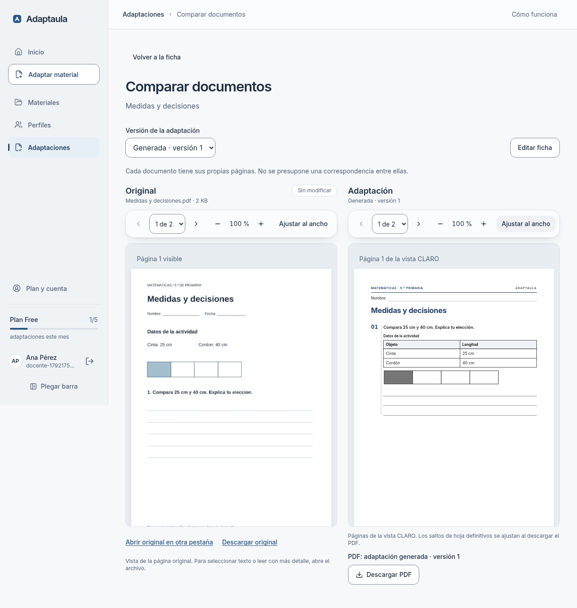
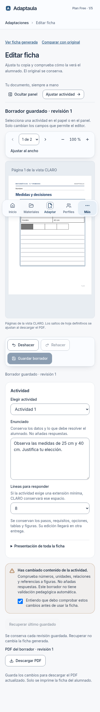

# Adaptaula 2.0 — Etapa 2B: comparación y edición contextual

2026-10-16. Base `330cb4f` (`main`, PR #40 integrada); rama `codex/adaptaula-2-comparacion-editor`. [PR #41](https://github.com/TinyChat-up/ADAPTAULA/pull/41) abierta para revisión, sin merge. No se han utilizado APIs pagadas, datos reales de alumnos, Supabase remoto ni Stripe.

## Qué se puede utilizar

- Desde la ficha entregada: comparar el original privado con CLARO, en paralelo si hay espacio o alternando en móvil. Páginas y zoom independientes; se conservan al alternar. No hay sincronización supuesta.
- Elegir adaptación generada o último borrador válido guardado de la base actual. Etiqueta explícita de versión y PDF; ninguna edición sin guardar se ofrece como versión descargable.
- Seleccionar una actividad con clic/Enter/Espacio o selector. Abre y enfoca su inspector; navegar de página cambia el contexto. Panel plegable y presentación global desplegable.
- Editar los campos ya admitidos: enunciado, espacio del mismo tipo de respuesta y presentación. Deshacer/rehacer, guardar, recuperar y descargar la revisión persistida mediante el endpoint existente. Aviso pedagógico obligatorio al cambiar contenido.
- Lectores comparan sin controles de edición. Original y versión entregada permanecen intactos. No hay cambios de schema, cuotas, RLS, prompts, modelos, contratos pedagógicos ni dependencias.

## Evidencia visual

Capturas reales de Chromium: escritorio 1280 × 900 y móvil 390 × 844, página completa. El documento de dos páginas y las identidades de prueba son sintéticos (`tests/support/review-documents.ts`). Las capturas no son un diseño recreado ni una validación docente.

| Vista | Escritorio | Móvil |
| --- | --- | --- |
| Original | [Captura](original-desktop.png) | [Captura](original-mobile.png) |
| Comparación generada | [Captura](comparacion-desktop.png) | [Captura](comparacion-mobile.png) |
| Edición contextual | [Captura](editor-desktop.png) | [Captura](editor-mobile.png) |
| Borrador guardado | [Captura](borrador-desktop.png) | [Captura](borrador-mobile.png) |





Se inspeccionaron las capturas. Se alineó el inicio de ambos papeles, se corrigió un desbordamiento del selector/alternancia a 320 px con texto al 200 % y se acercó el feedback de guardado a sus controles. Solo navegación y herramientas usan las superficies de etapa 1; papel y actividades siguen sólidos. No hay nuevos efectos costosos, animación constante ni código de las referencias externas.

## Verificación

| Comprobación | Resultado |
| --- | --- |
| Unitarias/integración focalizadas, 11 archivos | 144/144 PASS |
| PDF focalizado (editor y ruta de exportación), Chromium real | 9/9 PASS |
| E2E comparación, permisos, conflictos, editor previo y workspace 2A | 12/12 PASS, escritorio/móvil |
| Repetición del recorrido principal tras el ajuste final de feedback y prueba ampliada de texto | 2/2 PASS; incluidos en los escenarios anteriores, no sumados como nuevos |
| Typecheck, lint completo y build | PASS |
| Smoke raster y PDF sobre artefacto compilado local | PASS; smoke PDF incluye 39/39 pruebas (los 9 anteriores están incluidos) |
| Escaneo de secretos en bundles, páginas, resultados y snapshots | PASS |

Los E2E prueban original de dos páginas, navegación/zoom independientes, alternancia de versiones, selección por teclado y foco, edición/aviso/deshacer/rehacer, guardado/recarga/recuperación, PDF de revisión 1, SHA-256 del original y documento generado intactos. Se prueba 404 entre usuarios, rol lector sin edición y escritura 403, borrador sin reconocimiento rechazado y descarga 409, y conflicto entre pestañas sin sobrescritura. Axe sin violaciones graves/críticas en las vistas probadas, movimiento reducido, colores forzados y reflujo a 320 px/texto 200 % en comparación y editor. No equivale a certificación WCAG ni prueba con lectores de pantalla/Safari físicos.

**Defecto reproducido antes de corregir:** «Recargar borrador guardado» era un enlace a la misma ruta; tras un conflicto conservaba la edición local y no cargaba la revisión nueva. La prueba del botón real falló. Ahora realiza una recarga completa, conserva la confirmación nativa ante cambios pendientes y obtiene la versión persistida. No se altera el protocolo de conflictos.

Pruebas de asociación verifican orden, etiquetas, enunciados duplicados, recursos agrupados, repaginación y discrepancias de proyección. Las pruebas de HTML predeterminado y PDF comprueban que no aparecen atributos de edición/selección, claves ni páginas ocultas en la salida de impresión. Se conservan tablas, figuras y opciones.

### Reproducción

Se utilizó la instalación existente, con binarios locales equivalentes a los scripts pnpm:

```sh
node_modules/.bin/vitest run tests/unit/document-review.test.ts tests/unit/document-workspace.test.ts tests/unit/design-foundations.test.ts tests/unit/sheet-editor.test.ts tests/unit/editor-save-route.test.ts tests/unit/pdf-single-renderer.test.ts tests/unit/boundaries.test.ts tests/unit/student-sheet-design.test.ts tests/db/sheet-editor.test.ts tests/db/pdf-export.test.ts tests/db/adaptation-entitlements.test.ts
node_modules/.bin/vitest run --config vitest.pdf.config.mts tests/pdf/editor.test.ts tests/pdf/export.test.ts
node_modules/.bin/playwright test document-review.spec.ts sheet-editor.spec.ts document-workspace.spec.ts
node_modules/.bin/next typegen
node_modules/.bin/tsc --noEmit
node_modules/.bin/eslint
node_modules/.bin/next build
node scripts/smoke-raster.mjs
node scripts/smoke-pdf.mjs
node --env-file-if-exists=.env.local --import tsx scripts/check-secrets.ts
```

Esta sesión usó una copia externa de la configuración Playwright, con `/usr/bin/chromium`, servidor Next 3131, fake Supabase/PGlite 54431 y `.next-e2e-review` para aislarla de otra sesión local. Se retiraron los includes temporales que Next añadió a tsconfig. El build usa valores locales ficticios de Supabase, modelos `mock:default` e imágenes desactivadas. No se publica ninguna configuración secreta. No se repitió la suite general de aplicación.

**Simulación explícita:** registro/subida/análisis/plan recorren la aplicación local con proveedor simulado; la adaptación entregada se prepara con un `MaterialDocument` determinista. La exportación sí utiliza el renderer y Chromium reales. Estos resultados no validan la calidad del generador con modelos reales, ni prueban un despliegue en Vercel.

## Límites y siguiente paso

- CLARO muestra páginas lógicas; el PDF puede introducir saltos físicos adicionales. Se indica junto al visor. No se inventa correspondencia con el original.
- Solo se compara el último borrador válido de la base actual. No hay explorador del historial, autosave ni comparación de cambios transitorios.
- Recuperar último guardado restaura la copia cargada/guardada en esta sesión; ante modificaciones concurrentes, la recarga explícita obtiene la última del servidor.
- Figuras, tablas, opciones, claves y estructura no son editables. El aviso no demuestra corrección pedagógica ni puede detectar toda respuesta que un docente escriba en un enunciado.
- El original conserva el raster privado a 110 ppp y sus límites existentes. Rendimiento/coste del raster en Vercel y documentos grandes no medidos en esta entrega.
- Se conserva la proyección académica, CSS de impresión y exportación. El template compartido solo añade props opcionales de selección/visibilidad de pantalla, ausentes al exportar PDF; no existe un segundo renderer.

Revisar esta PR antes de la etapa 3: mesa docente, biblioteca, perfiles, historial y cuenta. Sin merge automático ni ampliación experimental del pipeline.
