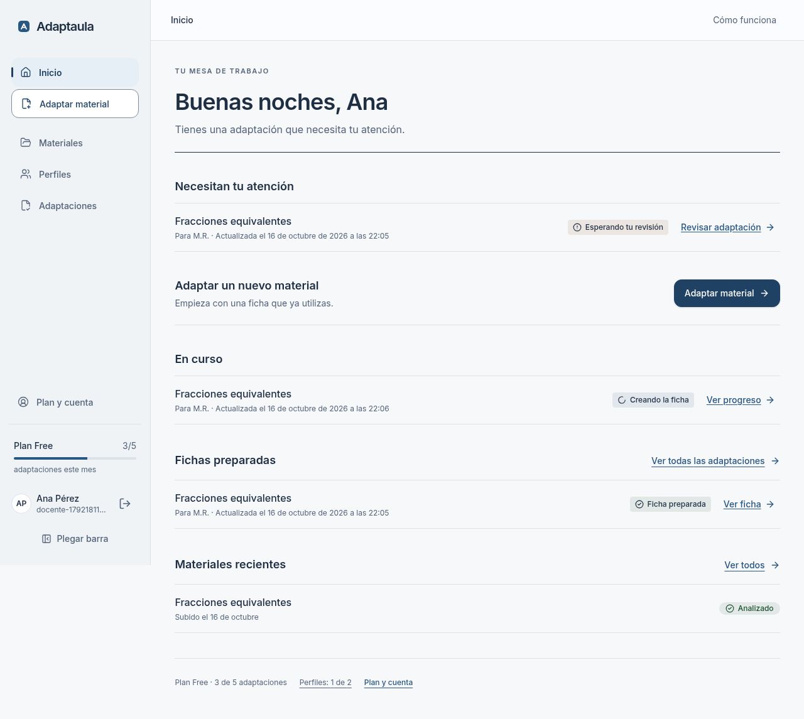
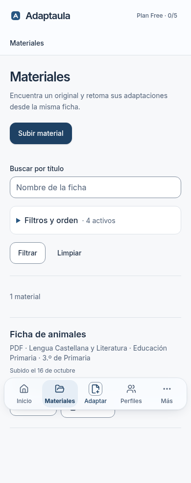

# Adaptaula 2.0 · Etapa 3A: mesa, biblioteca e historial

2026-10-16. Base `740e2db` (`main`, PR #41 integrada); rama `codex/adaptaula-2-mesa-biblioteca-historial`. Primera entrega de la Etapa 3 en [PR #42](https://github.com/TinyChat-up/ADAPTAULA/pull/42), para revisión sin merge. Perfiles y Plan y cuenta corresponden a 3B.

## Comportamiento entregado

- Mesa docente: fichas que necesitan atención antes de empezar un material, seguido de trabajos en curso, preparadas y materiales recientes. Las etiquetas y próximas acciones vienen de los estados existentes; consumo y perfiles son lecturas reales del workspace.
- Biblioteca: búsqueda visible por título sin distinguir mayúsculas y filtros/orden secundarios en un desplegable nativo que indica cuántos están activos. Etapa, curso, asignatura, estado y orden por fecha o título. Se aplican en la consulta autorizada antes del límite de 200, que se comunica si se alcanza. Los materiales a medio subir nunca aparecen, aunque se fuerce un parámetro de URL. La ficha de material contiene sus adaptaciones cuando existen.
- Historial: estado, perfil funcional asociado cuando existe, fechas de creación/actualización y enlace a la ficha original. Las preparadas ofrecen comparación, edición si el rol permite escribir y PDF generado mediante el endpoint actual. El comparador de 2B permite elegir el último borrador válido; el historial no presenta una versión transitoria como descargable. Se indica que lista las últimas 100 adaptaciones.
- Un error de consulta de adaptaciones muestra el estado de error de la aplicación, no un historial vacío engañoso. No se cambian contratos del pipeline, CLARO, borradores, RLS ni cuotas.

## Capturas reales

Documento y cuentas sintéticas, navegador Chromium, escritorio 1280 × 900 y móvil 390 × 844. Ninguna cifra o ficha mostrada se ha inventado en el componente. Se inspeccionaron las vistas capturadas.

| Pantalla | Escritorio | Móvil |
| --- | --- | --- |
| Mesa | [Captura](mesa-desktop.png) | [Captura](mesa-mobile.png) |
| Biblioteca filtrada | [Captura](biblioteca-desktop.png) | [Captura](biblioteca-mobile.png) |
| Historial de ficha preparada | [Captura](historial-desktop.png) | [Captura](historial-mobile.png) |





## Verificación y límites

Las pruebas E2E usan PGlite/Supabase simulado local con migraciones reales y el proveedor simulado; la versión preparada del recorrido se siembra con un documento determinista. Verifican búsqueda/orden/filtros, datos y permisos de dos workspaces, estados, acciones, descarga disponible, responsive, teclado/foco y axe sin violaciones graves/críticas en vistas probadas. Se probaron movimiento reducido, colores forzados y 320 px con texto al 200 %. Las capturas no son validación pedagógica del generador real ni certificación WCAG.

El recorrido simulado de análisis se quedó una vez en «Preparando» durante la primera ejecución E2E; se repitió sin cambiar el pipeline y completó. Los fallos reales de la biblioteca a 320 px/texto 200 % se corrigieron acotando los campos y permitiendo que los botones pasen de línea. Los filtros secundarios se plegaron; al detectar que React podía cerrar el control nativo entre elecciones, se dejó su apertura en manos del navegador y la prueba recorre etapa, curso y asignatura en la misma sesión. Una fila inicialmente ofrecía un ancla a adaptaciones incluso sin ninguna; ahora abre la ficha de material, cuya sección de adaptaciones solo aparece cuando existe. El historial se reorganizó en dos líneas tras inspeccionar la captura para que título y acciones no compitan.

**Comprobaciones finales:** 92/92 pruebas focalizadas en cinco archivos (estados, materiales, permisos, PGlite) y 2/2 pruebas de las acciones del historial. Seis recorridos E2E distintos en escritorio/móvil: portada, mesa/historial y biblioteca. La biblioteca compacta se repitió 2/2 tras corregir el comportamiento del desplegable; no se suma como escenarios nuevos. Typecheck PASS, lint PASS (aviso heredado `_id` en `tests/unit/analysis-run-auth.test.ts`), build PASS. El escaneo de secretos sobre el build final pasó: 110 archivos inspeccionados, sin secretos expuestos.

Comandos utilizados con la instalación existente:

```sh
node_modules/.bin/vitest run tests/unit/adaptation-list-state.test.ts tests/unit/boundaries.test.ts tests/unit/materials-core.test.ts tests/db/materials.test.ts tests/db/adaptation-ui-flow.test.ts
node_modules/.bin/vitest run tests/unit/stage3-list.test.ts
node_modules/.bin/playwright test --config /workspace/adaptaula-setup/stage3.playwright.config.mts library-stage3.spec.ts editorial-interface.spec.ts
node_modules/.bin/next typegen
node_modules/.bin/tsc --noEmit
node_modules/.bin/eslint
node_modules/.bin/next build
```

La configuración E2E fuera de Git usa Next 3131, PGlite local 54431, Chromium del sistema y modelos `mock:default`; se retiraron los includes/cachés temporales generados por Next. No usa datos externos.

 No se repitió la suite completa de aplicación; el alcance se verificó con pruebas focalizadas, PGlite y recorridos de navegador pertinentes. Sin APIs de pago, Supabase remoto, Stripe, alumnos reales ni nuevos precios/cuotas.

**Límites declarados:** hasta 200 resultados de biblioteca y 100 adaptaciones recientes en historial; falta paginación completa para workspaces mayores. El historial enlaza al comparador para distinguir generada y último borrador guardado; no presenta un historial visual de todas las revisiones. La ficha PDF real se probó en la etapa 2B; 3A reutiliza la misma acción de descarga y no cambia el motor. Calidad del pipeline real y runtime Vercel siguen fuera del alcance de estas pruebas locales.

**Siguiente paso:** revisar e integrar esta PR y después realizar 3B (perfiles funcionales y Plan y cuenta). La política Free/Pro/Max y precios nuevos siguen reservados a la etapa 4, con migración y pruebas propias.
