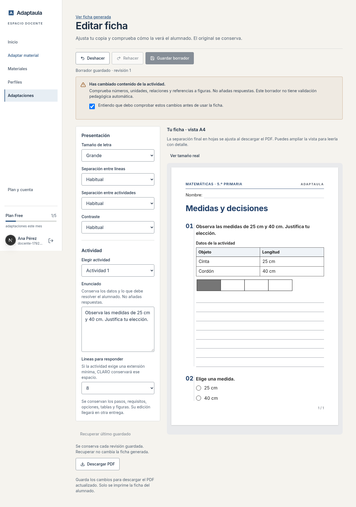

# Editor docente · primera entrega operativa

Base `origin/main` / `b192735`; rama `codex/editor-docente-claro`. El historial remoto ya incluía el merge de #37 al comenzar. No se modificó ni fusionó esa PR en esta sesión.

## Uso

1. Abrir una adaptación entregada → «Ver la ficha» → «Editar ficha».
2. Ajustar letra, separación, contraste, enunciado o espacio para responder.
3. Ver el resultado A4 al ancho disponible, o ampliarlo a tamaño real. Usar Deshacer/Rehacer si hace falta.
4. Si cambia el enunciado, reconocer el aviso de que debe comprobarse su contenido. Esto no valida el cambio.
5. Guardar borrador. Recargar o «Recuperar último guardado» recupera esa revisión.
6. Descargar PDF. La descarga se desactiva mientras hay cambios sin guardar y usa la revisión concreta guardada.

## Alcance y conservación

- La ficha generada, su revisión pedagógica, los materiales y el PDF original siguen intactos. La vista/descarga habitual continúa mostrando esa ficha; la del editor usa el borrador.
- No se edita estructura ni contenido de tablas, figuras, opciones, pasos, requisitos, lecturas, claves o notas docentes. Se conserva su identidad, orden y asociación con las actividades.
- Las líneas no eluden el mínimo de espacio que CLARO deriva de una consigna con extensión explícita. Una caja conserva su formato; solo cambia el tamaño.
- Todo cambio de enunciado se trata como pedagógico, también un número o unidad. Aviso y reconocimiento explícito, sin decir «validado». El docente debe comprobar que no ha añadido respuestas ni cambiado el aprendizaje.
- No se promete detectar respuestas o errores semánticos escritos manualmente. La clave/notas no llegan al cliente del editor ni al modelo de render del alumno.
- Se reutilizan `sheetModel`, `MaterialSheet`, CSS, recursos privados y exportación Chromium existentes. La escala de pantalla no cambia el PDF. Corrección mínima de numeración: ampliar la letra ya no divide «01» en dos líneas.

## Guardado y permisos

Migración **025**, incluida y ejecutada únicamente en las bases de prueba locales. Es necesaria antes de desplegar el editor; no se ejecutó SQL en Supabase remoto.

`adaptation_drafts` conserva cada revisión junto con versión base, autor, fecha, cambios y constancia del aviso. Compartido por miembros del espacio autorizado, como la ficha. No es una colección para entrenamiento. Solo la RPC de sesión puede añadir revisiones: comprueba pertenencia, rol y versión/revisión bajo bloqueo de la adaptación. No hay UPDATE/DELETE directo para usuarios autenticados. Una pestaña desactualizada recibe conflicto, sin sobrescribir la última revisión. Toda lectura para mostrar/exportar valida otra vez el parche; un registro inválido no entrega PDF ni cae al original silenciosamente.

## Verificaciones

- **94 pruebas focalizadas** en ocho archivos: edición/preservación/historial, endpoint de guardado, migraciones/RLS, única cadena de render, fronteras cliente/servidor, descarga, regresión del endpoint PDF y diseño de la ficha.
- **9 pruebas PDF** en `tests/pdf/editor.test.ts` y `tests/pdf/export.test.ts`: Chromium real, tablas y recortes reales locales, lectura posterior del texto, clave excluida, revisión concreta y original intacto. El caso nuevo se repitió después del ajuste de numeración.
- **2 E2E** (ordenador y móvil): editar → aviso → deshacer/rehacer → ajustar letra/líneas → guardar → recargar → recuperar → descargar → original intacto. Sin desbordamiento de la página y sin incidencias graves/críticas de accesibilidad en controles; no certifica accesibilidad completa de todas las fichas.
- **Typecheck y build PASS**; lint sin errores, con un aviso previo `_id` en `analysis-run-auth.test.ts`; diff check PASS.
- Sin suite completa ni servicios remotos. Binarios locales equivalentes a los scripts pnpm; los E2E se lanzaron con configuración externa de puertos aislados y Chromium del contenedor. Una ejecución inicial de lint recorrió la caché temporal de Next; se retiró la salida generada y el comando normal pasó.

Comandos principales:

```bash
node_modules/.bin/vitest run tests/unit/sheet-editor.test.ts tests/unit/editor-save-route.test.ts tests/db/sheet-editor.test.ts tests/unit/pdf-single-renderer.test.ts tests/unit/boundaries.test.ts tests/unit/pdf-download.test.ts tests/db/pdf-export.test.ts tests/unit/student-sheet-design.test.ts
node_modules/.bin/vitest run --config vitest.pdf.config.mts tests/pdf/editor.test.ts tests/pdf/export.test.ts
node_modules/.bin/playwright test sheet-editor.spec.ts
node_modules/.bin/next typegen && node_modules/.bin/tsc --noEmit
node_modules/.bin/eslint
node_modules/.bin/next build
```

## Capturas de la aplicación funcionando

Fichas, cuenta y alias **sintéticos** de las pruebas. No son materiales de alumnado ni validación pedagógica del generador. PDF de demostración conservado como artefacto local; no se publican originales del corpus.

[Ordenador](desktop.png) · [Móvil](mobile.png)



## Límites y siguiente entrega

Guardado explícito, sin autosave ni lista navegable de revisiones antiguas. Historial de 50 cambios durante la sesión; recargar abre la última revisión guardada. La vista muestra páginas lógicas; el PDF determina los saltos físicos finales. No publica el borrador como versión canónica. Pendientes: probar el uso con docentes, y decidir después si conviene editar pasos u otros bloques con las mismas guardas.

Sin llamadas de pago, cambios de prompts/modelos, entrenamiento, Supabase remoto, Stripe o producción desplegada. El generador real no se ha validado con estas pruebas. El despliegue/Vercel y aplicar la migración remota quedan fuera de esta sesión.
