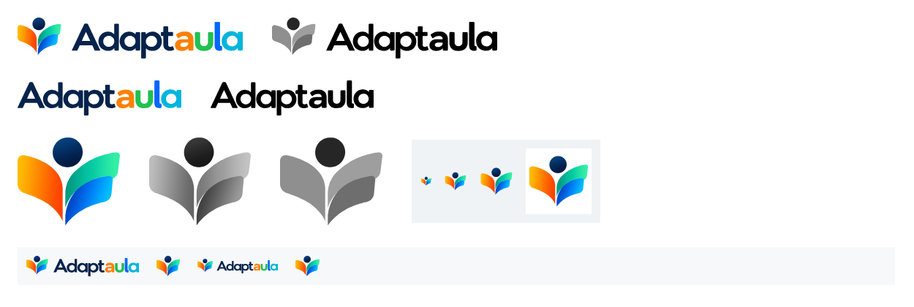

# QA — Fase C: identidad visual corporativa

Fecha: 2026-10-23 · Rama `claude/fase-c-marca`, que **parte de la #56** (`d04c73c`, sin fusionar) y depende de ella · `material_renderer@v7` · ADR-041 · [Marca](../../BRAND.md).

Sin IA de pago, sin tocar Supabase remoto, Stripe ni planes, y sin desplegar. CLARO sigue siendo el único diseño de la ficha. Se conservan:
- el motor `answer_space@v1` y las cuadrículas;
- los campos A–D y Flecha 1–4;
- las figuras originales;
- «Hacer magia»;
- la protección de respuestas, la paginación y la accesibilidad del perfil.

## 1. Activos

- **Fila 1:** logotipo horizontal en color y en una tinta.
- **Fila 2:** logotipo tipográfico en color y en una tinta.
- **Fila 3:**
  - el símbolo en color, en grises y en una tinta;
  - el favicon a 16, 32 y 48 px y el icono de Apple.
- **Fila 4:** tamaños de uso (cabecera, barra plegada y 6 mm de la ficha).

La fidelidad medida y el procedimiento están en [BRAND.md §2](../../BRAND.md).

## 2. Web: antes y después

Capturas reales de la app (`tests/e2e/brand-identity.spec.ts` con `BRAND_GALLERY_DIR`):
- **Antes:** el código de la #56.
- **Después:** esta rama.

| Pantalla | Comparación |
|---|---|
| Landing, escritorio | [landing-escritorio.png](web/landing-escritorio.png) |
| Landing, móvil | [landing-movil.png](web/landing-movil.png) |
| Acceso, escritorio y móvil | [login-escritorio.png](web/login-escritorio.png) · [login-movil.png](web/login-movil.png) |
| Bienvenida | [bienvenida.png](web/bienvenida.png) |
| Escritorio con la barra expandida | [panel-barra-expandida.png](web/panel-barra-expandida.png) |
| Escritorio con la barra plegada (solo el símbolo) | [panel-barra-plegada.png](web/panel-barra-plegada.png) |
| Escritorio, móvil | [panel-movil.png](web/panel-movil.png) |
| «Hacer magia» | [hacer-magia.png](web/hacer-magia.png) |
| Vista previa de la ficha | [vista-previa-ficha.png](web/vista-previa-ficha.png) |
| Landing completa (titulares en Outfit, pasos en los colores de «aula» y franja en el pie) | [landing-completa.png](web/landing-completa.png) |

El círculo negro con una «N», abajo a la izquierda, es el indicador de desarrollo de Next: no existe en producción.

## 3. Fichas con el símbolo oficial

Fichas sintéticas de la galería editorial, impresas por la ruta real del PDF (Chromium, HTML autónomo, CSP de impresión).

| Ficha | Vista previa | PDF real | PDF en grises | Archivo |
|---|---|---|---|---|
| Matemáticas 3.º, con cuadrícula | [vista](fichas/matematicas-vista-previa.png) | [página 1](fichas/matematicas-pdf-p1.png) | [grises](fichas/matematicas-pdf-p1-grises.png) | [matematicas.pdf](fichas/matematicas.pdf) |
| Lengua 5.º, con renglones y campos | [vista](fichas/lengua-vista-previa.png) | [página 1](fichas/lengua-pdf-p1.png) | [grises](fichas/lengua-pdf-p1-grises.png) | [lengua.pdf](fichas/lengua.pdf) |
| Ciencias 3.º, con esquema y A–D | [vista](fichas/ciencias-vista-previa.png) | [página 1](fichas/ciencias-pdf-p1.png) | [grises](fichas/ciencias-pdf-p1-grises.png) | [ciencias.pdf](fichas/ciencias.pdf) |

[El símbolo impreso a 600 ppp](fichas/simbolo-impreso-600ppp.png): curvas y degradados limpios, vectoriales.

Medido y comprobado en el PDF:
- **Presencia:** el símbolo está en la vista previa y en el PDF descargado. Lo prueban la E2E, el test de HTML de impresión y la galería PDF.
- **Vectorial:**
  - la ficha de Matemáticas, sin figuras, tiene **0** imágenes rasterizadas: el símbolo son 8 sombreados vectoriales;
  - la de geometría conserva solo su figura (1 imagen).
- **Autónomo:**
  - ninguna URL. Los únicos `url()` del HTML son las fuentes incrustadas y las referencias del símbolo a sus propios degradados (`#ms-brand-…`, en el mismo documento);
  - la CSP de impresión no cambia;
  - los recursos fijados del docente se tratan igual.
- **Tamaño físico estable:**
  - 6 mm de alto, en su proporción (829,7 : 713), una vez por ficha;
  - las ocho fichas de la galería conservan sus hojas (2, 2, 4, 2, 2, 2, 1 y 2), sus cuadrículas y sus campos: el símbolo no provoca saltos de página.
- **Blanco y negro:** las cuatro formas se distinguen en grises.
- **Contenido:**
  - no cambia el contenido educativo;
  - el modelo de render solo cambia en su versión (`material_renderer@v7`), así que su huella cambia por eso. La del CSS y la del HTML cambian por el símbolo y el acento.

## 4. Pruebas

- **Nueva E2E `brand-identity.spec.ts`** (escritorio y móvil). Comprueba que cada pieza oficial:
  - carga y tiene un `alt` vacío dentro de un enlace con nombre;
  - está dentro de la pantalla y en su proporción (±3 %);
  - aparece una sola vez por cabecera.

  Comprueba también la forma: los titulares en Outfit, los cuatro primeros pasos con los colores de «aula» en su orden, y «Hacer magia» en degradado con texto blanco, distinto de «Revisar antes de crear».

  Cubre la landing, el pie, el acceso, la bienvenida, el escritorio, la barra expandida y la plegada (solo el símbolo), la cabecera móvil, «Hacer magia» y la ficha (símbolo con nombre «Adaptaula», de 12 a 40 px, sin el logotipo horizontal).

  También comprueba:
  - los favicons, el icono de Apple y el manifiesto (iconos de 192 y 512 px), que sirve la propia app;
  - axe, sin infracciones graves;
  - que no hay desbordes.
- **Ajustadas a la marca, con revisión explícita y sin rebajar ninguna comprobación:**
  - galería PDF: la cabecera ya no tiene la palabra, sino el símbolo con nombre, de 6 mm, en su proporción y una vez por ficha;
  - diseño de la ficha: el símbolo en la cabecera, una vez y sin ``; el acento CLARO pasa a ser el azul marino de la marca;
  - HTML de impresión: solo se admiten las referencias del símbolo a sus degradados, además de las fuentes;
  - versión del renderer: v7 en unidad, BD y E2E;
  - flujo de «Hacer magia»: sigue siendo la acción principal y recomendada, ahora con su estilo propio (`btn-magic`), y «Revisar antes de crear» sigue siendo neutra.
- **Regresión encontrada y corregida:** el acento de marca (`#0064f6`) sobre su fondo suave daba 4,41:1 en la etiqueta «Próximamente» de precios. Pasa a `#0060eb` (4,73:1).
- **Resultados:**
  - unidad y BD: 1919 correctas y 13 omitidas;
  - PDF: 64/64;
  - typecheck correcto; lint con el aviso previo ajeno;
  - E2E de identidad: 4/4 en escritorio y móvil;
  - la suite E2E completa no se ha pasado sobre el código final (se interrumpió en la 9 de 128, sin fallos): queda para el cierre antes de fusionar.

## 5. Revisión crítica de la web

Desde un docente que llega por primera vez. Se separan los **defectos observables** de las **preferencias**.

**1. ¿Parece un SaaS profesional, actual y reconocible?**
- **Antes:**
  - profesional y sobrio, pero **no reconocible**: un cuadrado con una «A» provisional y la palabra en la tipografía del sistema;
  - ningún color propio: solo un azul medio (`#285782`) que no salía de ninguna pieza de marca.
- **Después:** el logotipo multicolor oficial en cada punto de identidad, el símbolo en las fichas y la interfaz en el azul marino de la marca. Es reconocible sin leer el nombre.

**2. ¿Se entiende rápidamente qué hace?**
- Sí: titular, subtítulo y una demostración interactiva.
- **Defecto corregido:** el subtítulo decía «Revísala con CLARO». CLARO es el nombre interno del diseño y no significa nada para un docente. También aparecía en los pasos de la landing, en la demostración y en dos textos del editor. Se sustituye por palabras corrientes.

**3. ¿Es sencilla para un docente poco tecnológico?**
- En general, sí: una acción principal por pantalla, textos en lenguaje del aula y nada de términos técnicos.
- La landing es larga (siete bloques). Es una preferencia, no un defecto: cada bloque responde a una duda real (cómo funciona, privacidad, precios, preguntas).

**4. ¿Sabe siempre cuál es la siguiente acción?**
- Escritorio, material y «Hacer magia»: sí.
- **Defecto pendiente, en la vista previa de la ficha:**
  - seis botones en tres filas;
  - el modo de vista seleccionado usa el estilo de botón principal, así que «Vista docente» parece la acción principal;
  - «Descargar PDF», el siguiente paso más probable, tiene el mismo peso que «Comparar con original».

  No se corrige aquí: reorganizar esa barra (modos de vista como selector, la descarga como acción principal) es un cambio de diseño con sus propios mensajes y diálogos. Va a la siguiente fase.

**5. ¿Hay elementos innecesarios o inconsistencias?**
- **Corregidas:**
  - la muestra de ficha de la landing usaba un azul propio (`#315a86`), distinto del de la ficha real, y no llevaba marca;
  - el acento de CLARO (`#23426b`) tampoco salía de la marca.

  Ahora los dos usan el azul marino, y la muestra lleva el símbolo como la ficha real.
- **Corregida, tras la revisión del responsable:** la forma de la interfaz no tenía relación con la marca. Los titulares iban en Georgia, en serif, junto a un logotipo geométrico redondeado, y los colores de marca solo aparecían en el logo. Ahora:
  - los titulares van en Outfit, medida como la tipografía más cercana al logotipo;
  - los pasos llevan los colores de «aula»;
  - «Hacer magia» tiene su propio azul de marca.

  Detalle en [BRAND.md §4](../../BRAND.md).

**6. ¿Se distingue lo que hace la IA de lo que decide el docente?**
- Sí, y ahora también se ve:
  - «Hacer magia», lo que hace la IA, va en el azul de marca, y lo que decide el docente, en azul marino;
  - «Hacer magia» y «Revisar antes de crear» se explican junto a cada botón;
  - la landing repite «El docente conserva la decisión final»;
  - la ficha final se puede editar.
- No se muestran modelos, costes ni porcentajes (lo comprueban las E2E existentes).

**7. ¿Transmite confianza y calidad pedagógica?**
- Sí: privacidad visible, sin diagnósticos, alias en lugar de nombres y fichas sobrias.
- La marca suma confianza porque la ficha impresa lleva el mismo símbolo que la plataforma.

**8. ¿La marca está integrada o solo se ha colocado un logo?**
- **Integrada:**
  - tokens corporativos (primario, acento y foco derivados de la marca, y variantes accesibles medidas);
  - el logotipo oficial en todos los puntos de identidad, sin duplicarlo;
  - el símbolo en la barra plegada y en las fichas;
  - favicon y manifiesto;
  - la muestra de la landing coherente con la ficha real.
- **No se ha hecho, a propósito:**
  - repartir los colores de marca por toda la interfaz;
  - usar el verde o el naranja como estados.

### Mejoras implementadas en esta PR

1. Las piezas oficiales en la landing, el pie, el acceso, la bienvenida, la barra lateral (horizontal o solo el símbolo), la cabecera móvil y la ficha.
2. Los tokens: azul marino como color de interfaz, el azul de marca como acento y foco, y los colores de marca con variantes accesibles medidas.
3. El favicon, el icono de Apple, el manifiesto y el color de tema.
4. El símbolo en la ficha CLARO, vectorial en el PDF, y el acento de la ficha en el azul marino de la marca.
5. Sin jerga interna («CLARO») en los textos del docente.
6. La muestra de la landing coherente con la ficha real.
7. La forma: los titulares en Outfit, los pasos en los colores de «aula», «Hacer magia» en el azul de marca y la franja de marca en la bienvenida y el pie.

### Pendiente para una fase posterior

1. **La barra de la vista previa** (defecto observable):
   - modos de vista como selector segmentado;
   - «Descargar PDF» como acción principal;
   - todo en una fila en escritorio.
2. **Una variante del logotipo para fondo oscuro**, cuando exista un tema oscuro.
3. **El símbolo en el pie de cada página** de una ficha, para hojas sueltas, a validar con docentes.
4. **Más acentos de marca puntuales** (iconos de sección, estados vacíos), con el mismo criterio y sin convertirlos en señales de estado.

## 6. Riesgos

- **Dependencia de la #56.** Esta rama la contiene. Si la #56 cambia antes de fusionarse, hay que integrarla aquí. La comparación de esta PR muestra también los cambios de la #56 hasta que se fusione.
- **Piezas trazadas desde imágenes rasterizadas.** La fidelidad está medida (§2 de BRAND.md), pero si la marca tiene originales vectoriales del diseñador, conviene sustituir estos SVG por aquellos, con los mismos nombres de archivo.
- **Cambio de color de la interfaz.** El primario pasa de `#285782` a `#063f79` y el texto a `#05234b`. axe no encuentra infracciones graves en las pantallas de la E2E, pero pantallas poco frecuentes pueden tener combinaciones no revisadas a mano.
