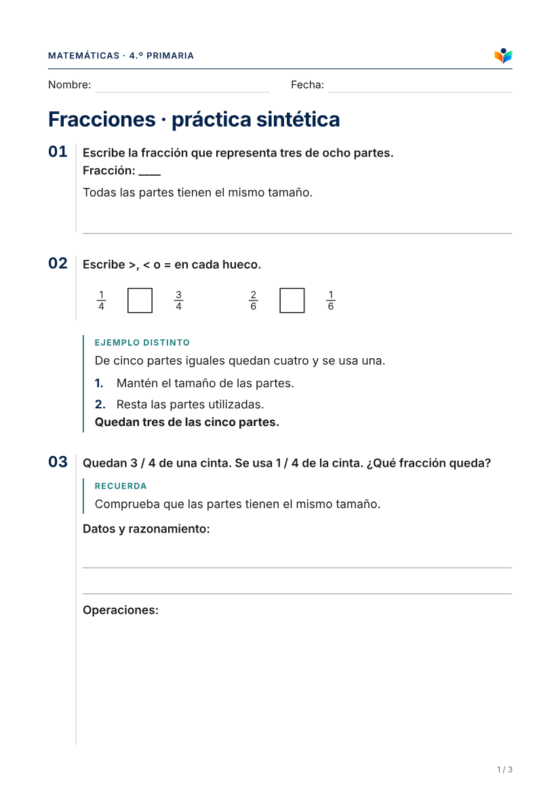
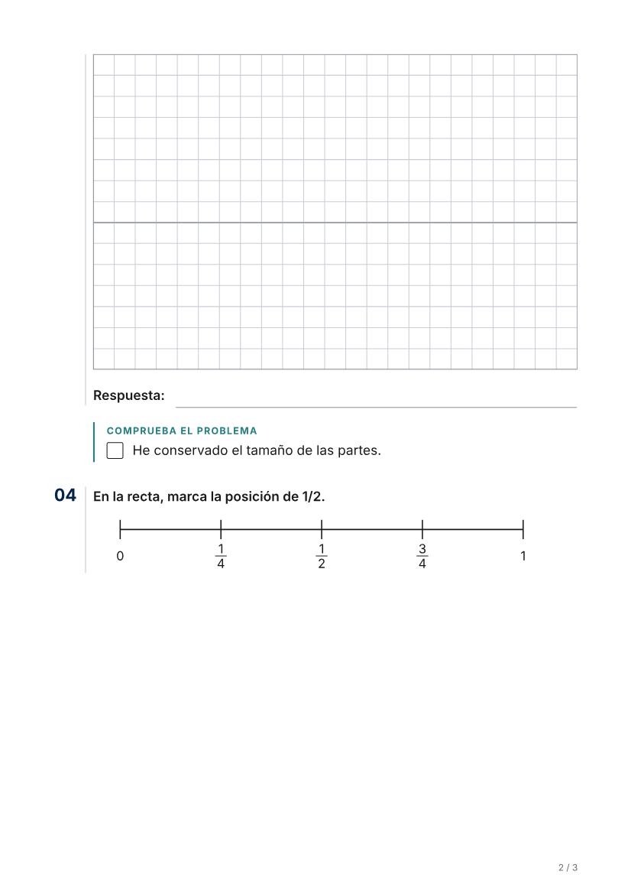
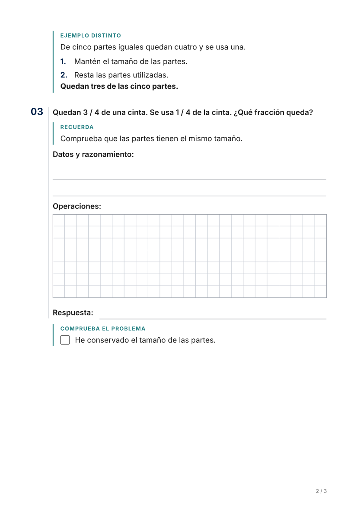
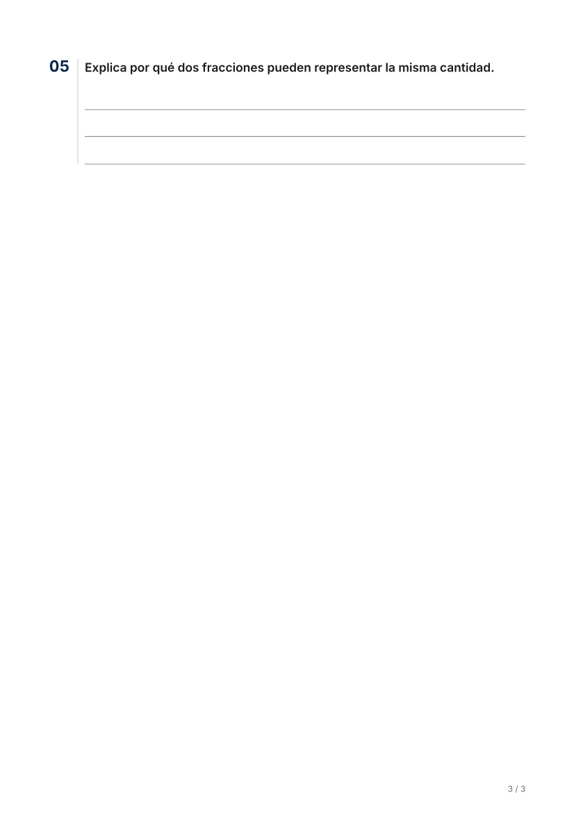
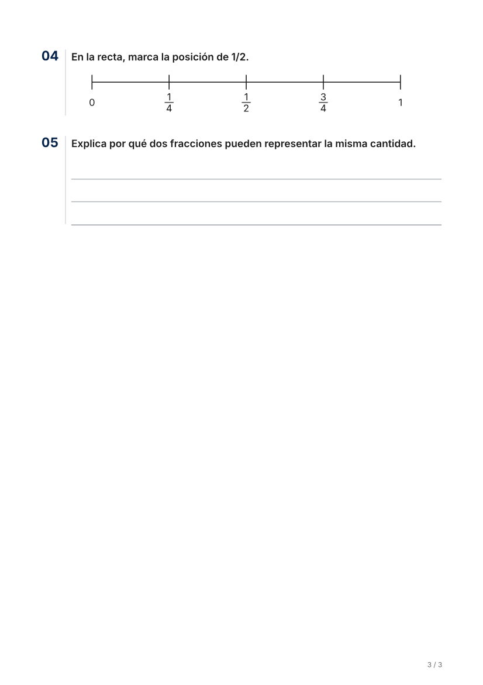
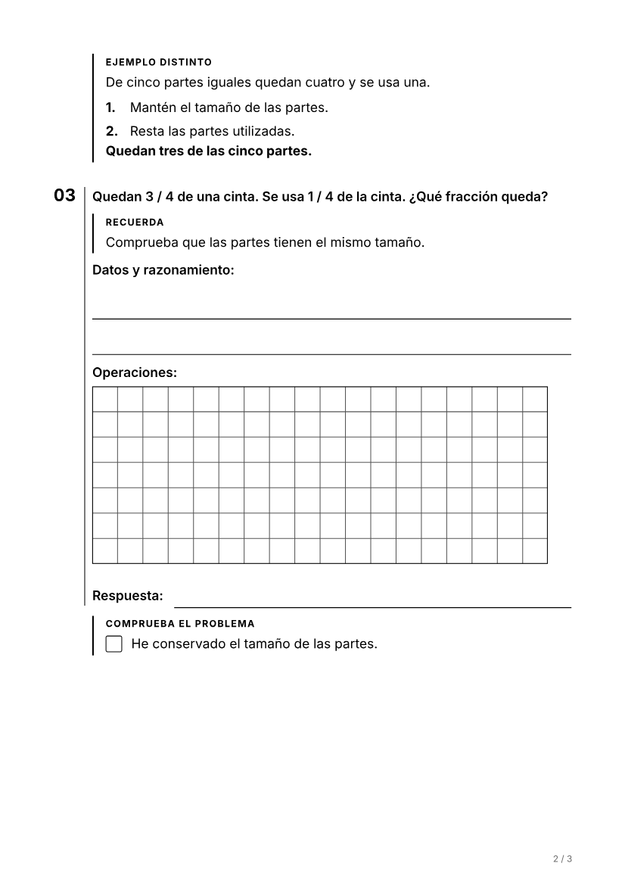

# Maquetación pedagógica · issue #64

23 de octubre de 2026. Base `fb314b2` de `main` (PR #62 integrada). Rama `codex/64-maquetacion-pedagogica`. [PR #65](https://github.com/TinyChat-up/ADAPTAULA/pull/65) abierta, sin merge.

**Material propio y sintético.** No se dispone del original privado de fracciones descrito en la issue ni de su adaptación de cuatro páginas. Esta comparación reproduce mecanismos del defecto; no demuestra que esa ficha concreta pase ahora de cuatro a dos o tres hojas. No hay IA ni validación docente en esta prueba.

## Defectos reproducidos antes del arreglo

Las tres primeras pruebas de `tests/unit/pedagogical-layout.test.ts` fallaban en main:

1. `Fracción: ____` al final de la consigna no se extraía como campo cuando también había contexto. Permanecía como texto en la consigna, junto a un área genérica. No se ha demostrado la desaparición total de ese texto en el caso privado.
2. `3 / 4` contaba como dos datos; además, `3/4` se contaba como una operación escrita. El problema de una resta, con apoyo en pasos, recibía **15 filas (105 mm)** en vez de **7 filas (49 mm)**. No se cambia la operación ni se escribe su solución.
3. El ensamblador hacía grupos 4 + 1 antes de que el renderer aplicara su reparto equilibrado. Ahora ambos utilizan la misma función: 2 + 3, respetando el máximo del perfil y las páginas de origen.

La nueva prueba PDF fallaba porque la página con el enunciado y las operaciones no contenía «Respuesta». El ejemplo y la comprobación tampoco formaban una unidad de paginación completa. La última hoja contenía únicamente la actividad 5.

## Cambios

- `activityStructure`: conserva los campos identificados tanto en consigna como en contexto, en su orden. No inventa etiquetas ni elimina repeticiones de respuestas.
- `answer_space@v2`: reconoce fracciones con espacios y diferencia una fracción de una expresión aritmética. Sigue respetando la superficie original, los formatos de respuesta decididos y las necesidades motrices. No se reducen cuadrículas guardadas ni superficies originales para ahorrar hojas.
- `taskGroups`: una función compartida por ensamblador y renderer; elimina el reparto previo que dejaba una actividad aislada.
- `material_renderer@v8`: una unidad agrupa ejemplo, actividad, figuras, apoyos, respuesta y comprobación final vinculada por referencias. La comprobación sigue **después** de la respuesta, nunca como una pista anterior.
- Una estimación conservadora habilita `break-inside: avoid` para la unidad que puede caber. Las unidades extensas siguen por los puntos existentes: campos, líneas y zonas de cuadrícula, sin recortar contenido.
- Las dos últimas actividades de una página lógica pueden viajar juntas si su altura estimada combinada no supera media hoja útil. Evita dejar una tarea corta sola sin imponer un número de páginas. El navegador determina la paginación física.
- Sin cambios en tokens de letra, márgenes, tamaño de casilla, color, marca, figuras, prompts, modelos, claves, RLS, cuotas, almacenamiento ni exportador PDF. No hay migraciones.

## Comparación real de PDF

| Medida / observación | Main, antes | Después | Perfil con más espacio |
|---|---|---|---|
| Hojas físicas | 3 | 3 | 3 |
| Actividades | 5 | 5 | 5 |
| Cuadrícula del problema | 15 filas en zonas 8 + 7 | 7 filas | 7 filas |
| Casilla | 7 mm | 7 mm | 8,5 mm |
| Altura de cuadrícula | 105 mm en total | 49 mm | 59,5 mm |
| Renglón de escritura | 10 mm | 10 mm | 12 mm |
| Problema y respuesta | hojas 1 y 2 | juntos en hoja 2 | juntos en hoja 2 |
| Última hoja | solo actividad 5 | actividades 4 y 5 | actividades 4 y 5 |
| Campo Fracción | texto en consigna y línea genérica | campo etiquetado de una línea | campo etiquetado de una línea |

Las medidas del HTML de impresión se toman en Chromium con las mismas fuentes incrustadas y CSS del PDF. La salida se valida y rasteriza desde los bytes PDF; se comprueba qué textos están en cada hoja. La galería de B mantiene además sus pruebas de líneas visibles en el PDF convertido a grises, dimensiones, figuras y zonas de cuadrícula enteras.

- [PDF antes](antes/fracciones.pdf) · [PDF después](despues/fracciones.pdf) · [PDF con espacio motriz y alto contraste](motriz-grises/fracciones.pdf).
- [Medidas y distribución después](despues/report.json).

### El problema completo

Antes, en dos hojas:




Después, en una hoja:



### Última hoja




### Espacio adicional y escala de grises



## Verificación y reproducción

Sin Supabase remoto, pagos ni identidades reales. Se utilizan PGlite, proveedores simulados para las E2E, Chromium local para medidas y Chromium 153 del exportador para los PDF.

```bash
pnpm exec vitest run
pnpm exec vitest run --config vitest.pdf.config.mts
pnpm typecheck
pnpm lint
pnpm build
# Arrancar primero el entorno local de playwright.config.ts; no apuntar a staging:
E2E_BASE_URL=http://localhost:3100 E2E_CHROMIUM_PATH=/usr/bin/chromium pnpm exec playwright test
```

Para repetir solo la reproducción: `tests/unit/pedagogical-layout.test.ts` y `tests/pdf/pedagogical-layout.test.ts`. La última genera `.pdf-smoke/layout64-fracciones` y `.pdf-smoke/layout64-motriz-grises`. La referencia anterior se imprimió antes de modificar producción, sobre `fb314b2`, con el mismo fixture; sus tres pruebas unitarias y la comprobación PDF de respuesta en la misma hoja fallaron.

Resultados sobre el código de `bea206c`:

| Comprobación | Resultado |
|---|---|
| Suite de unidad y BD local | 1.933 correctas; 13 omitidas de servicios reales no autorizados |
| Regresión final focalizada de #64 | 7/7, incluida una comprobación adicional de no mutación y pertenencia de las comprobaciones |
| PDF completos, regresiones B y C incluidas | 66/66; sin cambiar líneas base de tinta |
| E2E completa, un trabajador, escritorio y móvil | **128/128**, 16,7 minutos |
| Typecheck | correcto |
| Lint | sin errores; aviso previo `_id` sin usar en `analysis-run-auth.test.ts` |
| Build | correcto, sin modificar fuentes ni producto para salvar problemas de red |
| `check:secrets` | 111 archivos; sin coincidencias; no había secretos reales cargados para búsqueda por valor |

[Registro E2E](e2e.txt). La E2E incluye descarga real, edición/guardado/recuperación, permisos y comparación; Hacer magia usa proveedor simulado, no acredita la calidad pedagógica de la IA. La primera ejecución E2E se interrumpió al detectar una discrepancia entre las claves **ficticias** del servidor local y PGlite; no fue un defecto de producto ni una prueba contra Supabase real.

## Límites

- El reparto y el conteo de operaciones siguen siendo heurísticas. La altura real depende de textos, fuentes, figuras y perfil. No se promete un número fijo de hojas ni ausencia universal de huérfanas.
- Los documentos ya guardados mantienen su respuesta y sus páginas lógicas: el renderer no borra espacio almacenado ni recupera etiquetas ausentes de sus datos. Las correcciones del ensamblador y del motor de espacios actúan al construir documentos nuevos. La agrupación visual sí se aplica al volver a imprimir una ficha existente.
- Un original identificado como cuadrícula heredada o recuadro amplio conserva su capacidad mínima aunque la operación sea sencilla. Reducirla sin evidencia de su superficie sería otra decisión, no este arreglo.
- Las marcas de la recta sintética permanecen intactas. La recuperación de marcas que faltan en un documento generado pertenece a #63, no se resuelve inventándolas en el renderer.
- La comparación mantiene tres hojas porque conserva márgenes, apoyos y espacio manuscrito. Es una mejora de integridad y equilibrio, no una reducción forzada del papel.
- Sin despliegue, merge ni validación de Chromium en Vercel. Falta revisión docente de estas fichas y prueba autorizada del caso concreto.

Integridad de los archivos de evidencia: `sha256sum -c docs/qa/maquetacion-pedagogica-64/SHA256SUMS`, desde la raíz del repositorio. [Medidas anteriores](antes/report.json).
