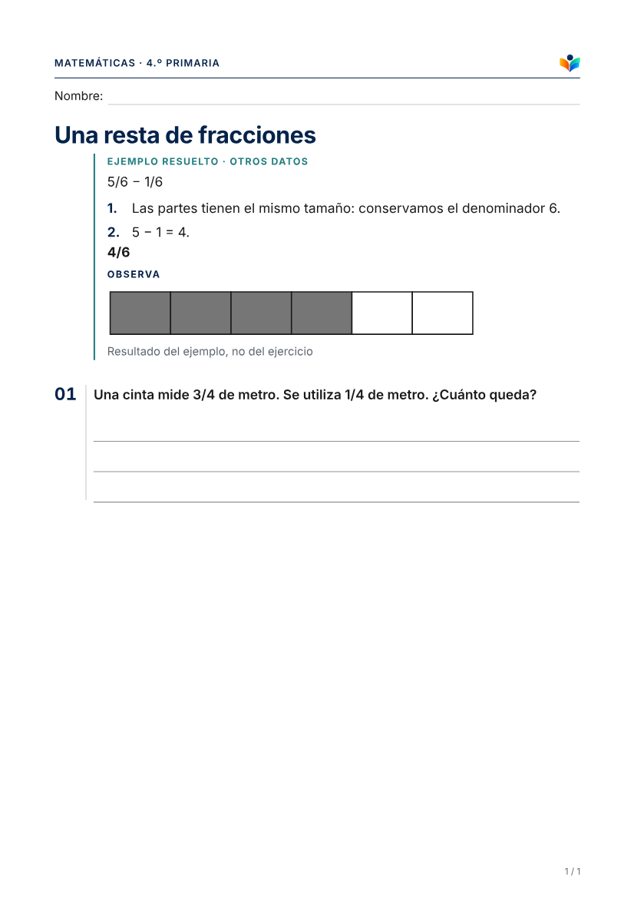

# Piloto aislado de recursos visuales Max

Base `56c899f` de main, con #65 integrada. Rama `codex/max-visuales-piloto`; [PR #66](https://github.com/TinyChat-up/ADAPTAULA/pull/66) abierta sin merge. Sin modificaciones de 024, 026, seed, precios, Stripe o servicios remotos. No se ha generado ninguna imagen con un proveedor real.

## Estado comprobado

| Capacidad | Estado y evidencia |
|---|---|
| A · Exactitud de fracciones, equivalencias y rectas | VisualSpec, aritmética racional y SVG existentes; PDF real de fixtures sintéticos. No utiliza IA de imagen ni cuota de imágenes. |
| B · Ilustraciones contextualizadoras | Pipeline existente: brief, generación, revisión, rechazo/reintento, hash, almacenamiento privado, `ai_runs` y cuota. Probado con dependencias simuladas y dibujos manuales, no con un modelo real. |
| C · Ejemplo visual resuelto | Nueva capacidad acotada `analogFractionBlocks`: suma/resta de fracciones propias con igual denominador, datos explícitos y cálculo determinista. Conserva la operación; rechaza datos o resultado equivalentes a los evaluados. No se selecciona automáticamente ni sustituye el ejecutor del generador: preparado y probado como piloto estructurado. |
| Contratación Max | En preparación; sin cambios. 026 mantiene **0 imágenes y `image_generation=false`** en catálogo. |
| Propuesta de 5 imágenes | Solo fixture en PGlite (`tests/support/max-pilot-plan.ts`), pendiente de aprobación comercial. No configura una base persistente ni concede Max a una cuenta real. |
| Disponibilidad actual del modelo | **NO VERIFICADA remotamente**. El SDK instalado `openai@7.24.0` declara `gpt-image-2.5-sunburst` y admite los parámetros utilizados. La consulta a documentación oficial fue bloqueada por la red (403). No se cambia el alias por suposición. |
| Modelos reales, costes y adecuación pedagógica | Pendientes del ensayo autorizado y revisión humana. Ninguna tasa de éxito de mocks acredita precisión de un modelo. |

## Auditoría y correcciones concretas

- El validador aceptaba un brief con `3/4`, una operación como `3 + 2 = 5` o ciertos recuentos exactos. Se reproducen antes del arreglo y se rechazan ahora. Etiquetas numéricas y etiquetas que coinciden con una respuesta corta tampoco pasan. Las reglas son conservadoras y no constituyen un clasificador semántico universal.
- Una evidencia de «raíz principal» podía acreditar a la vez «raíz» y «raíz principal», por coincidencia parcial. Ahora cada elemento necesita su comprobación propia y nombre normalizado completo. Puede rechazar sinónimos válidos: se prefiere esa parada a aceptar un elemento inexistente.
- Un SHA válido bastaba para leer una fila sin aprobación. Ahora caché y lectura exigen aprobación persistida; la ruta privada y el PDF usan ese resolvedor. Falta de metadatos falla cerrado.
- La ausencia de un recurso generado no podía distinguir una ayuda opcional de una imagen imprescindible. El servidor conserva `essential` en las fuentes generadas nuevas. Una opcional no disponible se excluye; una imprescindible bloquea. Los documentos anteriores conservan el valor prudente imprescindible cuando no existe esa información; las imágenes referidas directamente por una actividad siguen siendo imprescindibles.
- Una figura imprescindible para un cálculo podía caer en el flujo de ilustración contextual. Ahora la política impide esa sustitución para cálculo, problemas y magnitudes exactas: se necesita original verificado o representación determinista. No se usa una escena aproximada para completar una operación.
- Una llamada fallida con coste desconocido contaba como cero para admitir más llamadas. Una respuesta OpenAI sin uso reportado también se trataba como coste cero; ahora es desconocido. Se carga la estimación defensiva correspondiente; un error al leer gasto impide continuar. No se garantiza el importe de una factura externa ni una recuperación perfecta si falla la escritura de `ai_runs` después de una llamada facturable.
- Se mantiene el techo de tres por adaptación y 0,50 USD defensivos. Además del límite de la política, la reserva consulta las aprobadas persistidas para no añadir una cuarta en ciclos posteriores. La exclusión de ejecuciones concurrentes depende también del lease del orquestador; no se sustituye por una nueva transacción distribuida en este piloto.
- El ejemplo análogo utiliza el `worked_example` y `Figure` existentes. Una referencia explícita `example_ref` mantiene la figura dentro del ejemplo; una referencia incorrecta bloquea. Se evita mostrar la barra de un ejemplo bajo el ejercicio evaluado.
- El panel existente identifica el origen, presenta la finalidad guardada y pide revisar el PDF. También se muestra cuando Hacer magia ya ha completado sus recursos. No es una segunda interfaz de aprobación, y una revisión del modelo no se presenta como revisión docente.

Los campos opcionales `essential` y `example_ref` solo pertenecen a fuentes almacenadas por el servidor; no se amplía lo que el modelo puede dibujar. No requieren migración. CLARO conserva fuentes, márgenes, marca, espacios y paginación de #65; se reutiliza el mismo renderer.

## Evaluaciones y comparativas

Todas las fichas son propias y sintéticas. En B se dibujan dos escenas manualmente para probar transporte, privacidad y maquetación; la revisión está simulada. No son resultados de IA ni referencias validadas por docentes. [Resultados técnicos](evaluacion.json).

| Caso | Recurso / barrera atendida | Sin apoyo | Con apoyo |
|---|---|---|---|
| Fracciones y equivalencias | A · Particiones iguales y equivalencia, sin cambiar los datos dados | [PDF](pdf/fracciones-equivalencia-sin.pdf) | [PDF](pdf/fracciones-equivalencia-con.pdf) |
| Recta | A · Posición espacial; no se rotula el punto que hay que representar | [PDF](pdf/recta-sin.pdf) | [PDF](pdf/recta-con.pdf) |
| Problema de cantidades | C · Ejemplo con otros datos; el resultado del ejercicio no se imprime | [PDF](pdf/problema-ejemplo-sin.pdf) | [PDF](pdf/problema-ejemplo-con.pdf) |
| Ciencias y procesos | A · Secuencia de estados ya dados, sin inventar transiciones ni resultados | [PDF](pdf/procesos-sin.pdf) | [PDF](pdf/procesos-con.pdf) |
| Vocabulario y escena cotidiana | B · Contexto visual de biblioteca sin palabras escritas ni respuestas | [PDF](pdf/vocabulario-sin.pdf) | [PDF](pdf/vocabulario-con.pdf) |
| Ciencias | B · Planta y ventana para contextualizar; no dibuja cantidades ni da la explicación | [PDF](pdf/ciencias-sin.pdf) | [PDF](pdf/ciencias-con.pdf) |

[Ejemplo en monocromo](pdf/problema-ejemplo-grises.pdf) · [Escena en monocromo](pdf/vocabulario-grises.pdf).

También se prueban rechazos por respuestas reveladas, errores conceptuales, elementos prohibidos, mala impresión y desajuste de actividad; cuota agotada, reintentos, reutilización, devoluciones y aislamiento. Son pruebas del comportamiento ante señales controladas; no miden la capacidad real de visión para descubrir esos defectos en píxeles.

## Activación y ensayo manual

Ver [GUÍA DE PRUEBA](PRUEBA_MANUAL.md). El flag por sí solo no activa nada: se exige modo de piloto, backend exacto y un solo workspace; Vercel Production se rechaza. No se han configurado estos valores en un servicio remoto ni habilitado llamadas pagadas aquí.

El apoyo depende de la actividad, objetivo y nombres de apoyos funcionales enviados al brief por la política existente. No se envían alias ni identidades de alumnado. Un nivel alto en sentido numérico no modifica el ejercicio ni el nivel curricular; el constructor de ejemplo exige datos explícitos, no recibe un diagnóstico ni decide simplificar.

## Verificación

- E2E completa: **130/130**, escritorio y móvil, 17,3 min. Incluye Max ficticio en base local, propósito visible, aviso de revisión, lectura privada, PDF real y denegación entre cuentas. La generación del fixture se simula; no se invoca un proveedor de IA.
- PDF: **75/75**, 16 archivos de pruebas, incluidas regresiones B, C y #65, seis pares con/sin apoyo y dos monocromos. No se han regenerado líneas base para ocultar cambios.
- Regresión focalizada de dominio: **90/90**, incluidos costes desconocidos, matemáticas exactas, lectura aprobada, cuota y panel de Hacer magia.
- Unidad/BD completa: **1.948 correctas, 13 omitidas**, 136 archivos correctos y uno omitido. Typecheck y build correctos. Lint sin errores y con el aviso previo `_id` en `analysis-run-auth.test.ts`.
- Smoke raster correcto desde copia de ficheros trazados; smoke PDF correcto, incluidos Chromium, fuentes, ruta de producto y carga desde traza. Runtime Vercel **no verificado**. `check:secrets`: 111 archivos, sin coincidencias de los valores configurados localmente.
- Se ejecutaron los pasos completos de `check` con los binarios instalados, en el mismo orden. El lanzador `pnpm check` intentó reinstalar dependencias y abortó por falta de TTY; no se purgaron ni sustituyeron dependencias para ocultarlo.
- [Captura real escritorio](capturas/revision-desktop.png) · [Captura real móvil](capturas/revision-mobile.png). Cuenta y dibujos ficticios; la etiqueta de origen IA se prueba con una fila simulada. En móvil se conserva el visor A4 desplazable existente, sin rediseñarlo en esta entrega.
- La primera E2E completa detectó una expectativa desactualizada del texto y una medición de contraste durante una transición finita. Se corrigieron la expectativa y la espera del test; se mantienen las comprobaciones de accesibilidad. La ejecución final completa pasó sin reintentos.

Estas pruebas locales no equivalen a verificación de staging ni a validación pedagógica del generador real.

## Límites y siguiente paso

- La aprobación de visión sigue siendo una afirmación de un modelo. Puede aceptar una imagen errónea o rechazar una correcta; el contraste de nombres solo evita reutilizar indebidamente una comprobación.
- El helper C es intencionadamente estrecho. No hay selector automático nuevo, cobertura de denominadores distintos, números negativos, geometría arbitraria ni otro pipeline. No se incorporan ejemplos a las fichas reales automáticamente.
- La producción queda cerrada; la configuración de staging exige comprobar humanamente que el proyecto es aislado. Los secretos y la URL permitida son configuración de confianza del servidor, no prueba automática de la identidad de un proyecto.
- El presupuesto es una admisión defensiva basada en estimaciones históricas. Fallos de telemetría, ejecuciones interrumpidas y cargos tardíos del proveedor requieren reconciliación; no se afirma un límite absoluto de facturación.
- Una imagen opcional que no supera la revisión se omite; si falta una imprescindible, no hay entrega completa. El docente revisa el PDF; no se ha añadido un botón nuevo para retirar una imagen de una versión inmutable ya entregada.
- Próximo paso: revisar estas comparativas, aprobar o ajustar la propuesta de cinco y autorizar **una** ilustración real. Después medir resultado, costes y errores antes de ampliar el alcance.
