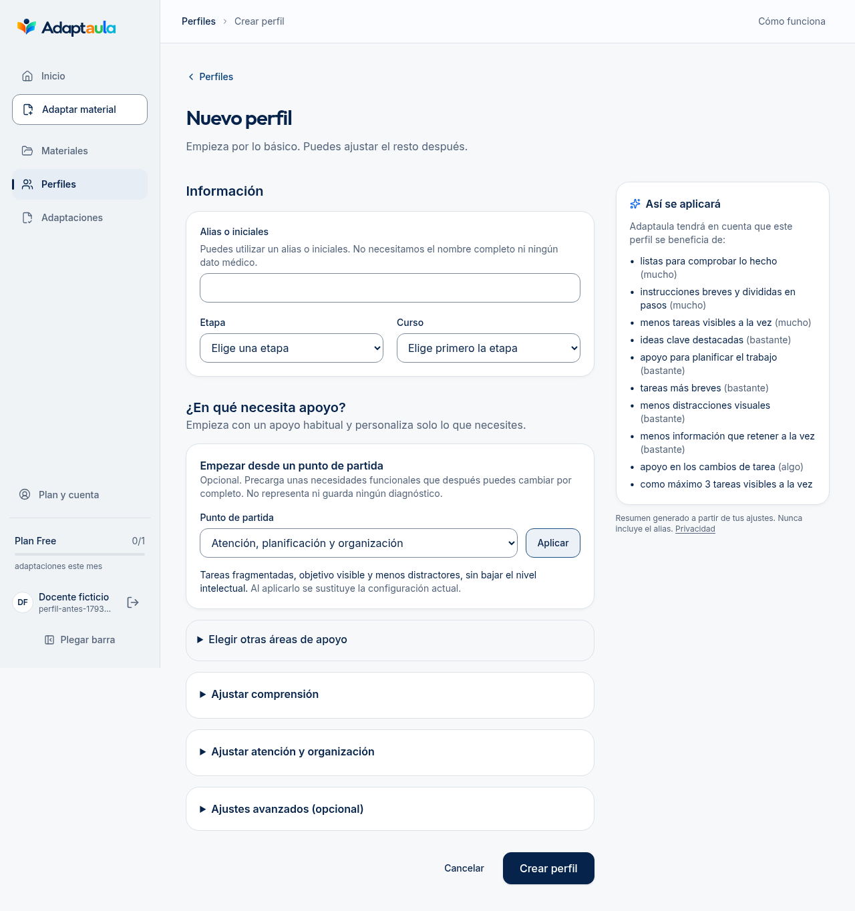
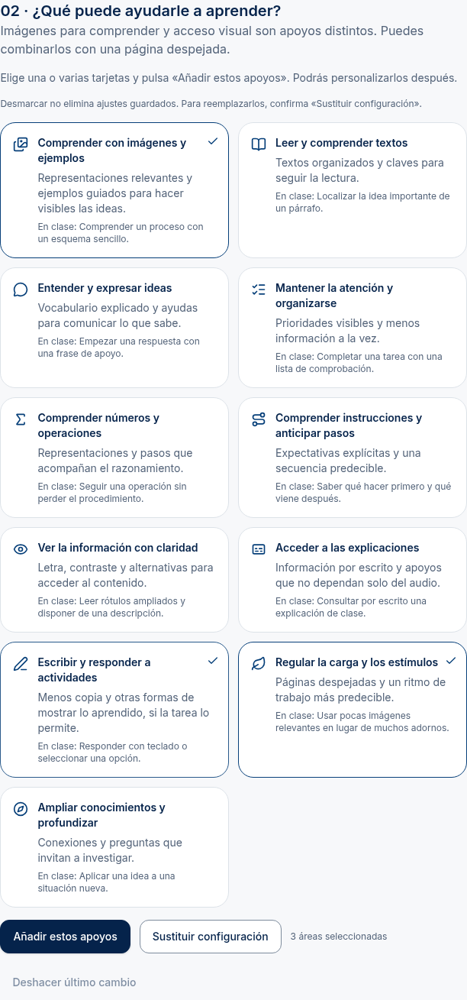
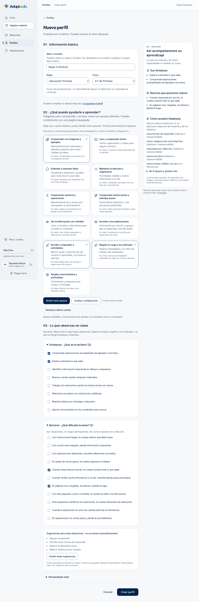
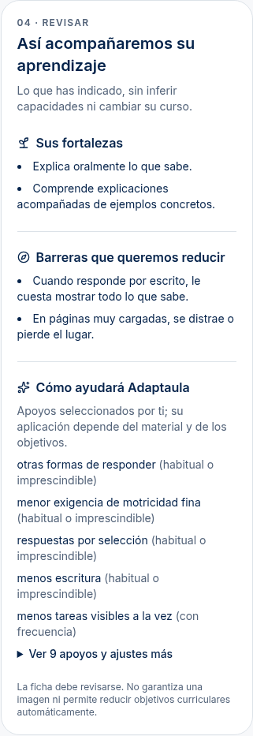
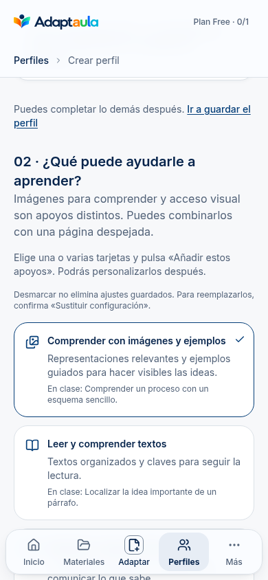

# Perfiles: fortalezas, barreras y apoyos

2026-10-26 · base `7d3dc15` (#75 integrada) · rama `codex/perfiles-fortalezas-barreras`.

[PR #76](https://github.com/TinyChat-up/ADAPTAULA/pull/76), abierta sin merge.

## Auditoría inicial y decisiones

Se inspeccionaron formulario, selector, controles, resumen, directorio, catálogo de áreas, textos, presets, borrador, schemas, repositorio, acciones y consumidores del contexto. Se leyó la issue #63 y se capturó el formulario original en esta sesión con identidad ficticia. No se auditaron ni alteraron otros subsistemas.

| Paso observado | Estado inicial y evidencia | Cambio |
| --- | --- | --- |
| 1. Datos básicos | Alias, etapa y curso, guardado y validación ya implementados | Se conservan; se aclara escolarización y se ofrece un acceso directo al guardado |
| 2. Elegir apoyos | Desplegable principal; aplicar sustituía configuración; cerrar un área borraba sus dimensiones | Once tarjetas combinables, suma conservadora, sustitución confirmada, cerrar solo cambia la visibilidad |
| 3. Describir cómo aprende | Solo dimensiones de apoyo; no había observaciones separadas | Ocho fortalezas y once barreras de catálogo, opcionales e independientes; sugerencias que requieren elección |
| 4. Revisar | Lista técnica larga en «Así se aplicará» | Tres bloques breves, prioridades visibles, resto desplegable y «no indicado» honesto |

El diseño se apoya en la interfaz existente de Adaptaula 2.0 y en la guía Product Design de revisión por capturas. Se conservan superficies, tokens, Lucide, formularios, diálogo nativo y renderer existentes. No se copia código externo ni se añaden dependencias.

### Antes y después

La captura anterior es de `main` antes de modificar el formulario. Las nuevas capturas se realizan sobre la app real local, con Auth/BD simuladas y cuentas ficticias; no son mockups ni validación del modelo de IA.











## Qué está implementado

- Vía rápida: guardar alias, etapa y curso sin completar campos opcionales. Vía detallada: propuestas de apoyo, observaciones, intensidad, límites y permisos. El formulario sigue en una sola ruta; no impone cuatro pantallas obligatorias.
- Tarjetas con título, explicación, ejemplo, icono, checkbox nativo y marca de selección. Se pueden combinar las once. Imágenes para comprender, acceso visual y menor carga son elecciones diferentes.
- Las tarjetas son propuestas para añadir. Al reabrir solo se marcan aquellas cuya configuración completa coincide con las dimensiones guardadas. No se almacenan como clasificación del alumnado ni como segunda fuente de verdad. Desmarcar no elimina apoyos; el resumen y los controles muestran la configuración efectiva.
- «Añadir estos apoyos» conserva los niveles mayores, límites más restrictivos, permisos, observaciones y los `none` explícitos. «Sustituir configuración» confirma el reemplazo de apoyos/límites/permisos y mantiene fortalezas/barreras. Veinte estados de configuración permiten deshacer antes de guardar; no se promete deshacer alias o escolarización.
- «Personalizar más» conserva todos los presets internos y dimensiones. Los nombres visibles siguen siendo funcionales. `visual_support` se muestra en comprensión aunque su grupo de schema histórico siga siendo audición; no se cambia el identificador consumido por el pipeline.
- Fortalezas y barreras solo se declaran mediante catálogo. Seleccionar una no deduce la otra ni activa apoyos. Las relaciones barrera→dimensiones sirven para sugerir; «Añadir estas sugerencias» las aplica por elección docente y permite ajustar su frecuencia.
- Intensidad: no indicado / no necesita / a veces / con frecuencia / habitual o imprescindible. Es frecuencia o necesidad del apoyo, no capacidad ni gravedad. El resumen distingue los `none` explícitos, no inventa fortalezas ni competencias y ordena los apoyos activos por prioridad.
- El repositorio existente guarda y duplica el estado completo. Las actualizaciones comprueban la revisión del formulario y hacen una escritura condicionada por `updated_at`, workspace e ID. Un conflicto conserva el estado del servidor e informa de que hay que recargar. Las pestañas anteriores no pueden degradar V2 desde la API nueva; 032 protege también escrituras de despliegues antiguos.

## Contratos y uso real en adaptación

`FunctionalProfileSchema` lee V1 y V2. El JSONB existente sigue siendo el almacenamiento; no hay tabla paralela. V2 admite `observations: { strengths: [...ids], barriers: [...ids] }` con IDs cerrados, límites de cardinalidad y rechazo de duplicados/campos libres. La ausencia de una dimensión es «no indicada»; `none` explícito se conserva en V2. En V1 se mantiene la compactación histórica, sin convertir masivamente filas. Editar o duplicar conserva los datos leídos; añadir observaciones o cambiar apoyos utiliza V2.

| Dato | Consumidor | Límite |
| --- | --- | --- |
| `supports`, intensidad | `activeSupports` → necesidades y presentación del contexto existente | Solo los apoyos explícitos son ejecutables; no se deducen de observaciones |
| `limits`, `allowances` | Reglas existentes de adaptación | No cambian cuotas ni permisos del workspace |
| `observations` | `learning_observations` opcional en el contexto y en el payload del planificador | IDs validados, sin alias ni texto personal. No se acredita que el modelo real haga buen uso de ellos |
| Etapa/curso | Escolarización del perfil; contexto educativo existente | No es competencia declarada por contenido ni autoriza bajar objetivos |
| Revisión temporal | API de edición y filtro atómico | No se envía a IA |

Sin observaciones, el contexto y su fingerprint histórico permanecen iguales aunque se lea el perfil como V2. Las adaptaciones previas y sus snapshots no se reescriben. Los cambios del perfil se aplican a futuras adaptaciones, no corrigen fichas entregadas automáticamente. No se modifican prompts, proveedores, modelos ni reglas de Hacer magia.

Ejemplo sintético: [perfil estructurado](perfil-sintetico.json). No contiene diagnósticos ni datos de un alumno real.

## Migración 032 y despliegue pendiente

Archivo: `supabase/migrations/20261001003200_profile_version_guard.sql`. Añade un trigger que rechaza V2→V1 (o retirar la versión) con un código genérico. No eleva privilegios, cambia RLS, altera cuotas ni convierte datos. Función de trigger sin ejecución pública. Se comprueba idempotencia aplicándola dos veces sobre una BD local con 031 y filas V1/V2 existentes.

Orden para un entorno compartido, **fuera de esta ejecución**:

1. Revisar y autorizar la aplicación de 032 sobre el esquema correspondiente; no basta con tener el fichero en Git. Se puede inspeccionar antes, sin contenido personal, `select functional_profile->>'schema_version' as version, count(*) from public.learner_profiles group by 1;`. Si aparecen versiones no admitidas, revisarlas sin convertir datos a ciegas.
2. Aplicarla antes de permitir escrituras V2. Comprobar que existe `learner_profiles_version_guard` y está habilitado:

```sql
select tgname, tgenabled
from pg_trigger
where tgrelid = 'public.learner_profiles'::regclass
  and tgname = 'learner_profiles_version_guard'
  and not tgisinternal;
```

3. Desplegar el lector V1/V2 y la interfaz en conjunto. Las filas V1 continúan siendo válidas; no ejecutar una conversión global.
4. Usar el dominio estable con el despliegue actual, cerrar/recargar pestañas antiguas y comprobar guardado/reapertura con un perfil ficticio, no con datos reales de menores.

**Reversibilidad:** antes de escribir V2, los V1 siguen intactos. Tras escribir V2, no es seguro volver a un despliegue que solo sepa leer V1: mantener el lector compatible y el trigger. No bajar la versión eliminando observaciones ni desactivar el trigger para hacer pasar un guardado antiguo. Una reversión que transforme datos exige revisión y conservación de esas observaciones; no se implementa un borrado silencioso.

No se ha aplicado SQL remoto ni desplegado producción. La protección de la API nueva no se presenta como defensa frente a servidores antiguos si 032 no está aplicada.

## Verificación y privacidad

Resultados locales de esta sesión (Node 24, Chromium y BD PGlite/fake del repositorio):

| Comprobación | Resultado |
| --- | --- |
| Unidad y BD completas | 2.049 correctas, 13 omitidas; 152 archivos, 98,31 s |
| PDF y smoke CLARO | 80/80; smoke correcto, runtime Vercel pendiente |
| E2E completa, una ejecución | 142 correctas, 4 omitidas por configuración previa; 18,6 min |
| E2E focalizadas con 032 desde arranque | 10/10, escritorio y móvil |
| PGlite de 032 y conflictos de escritura finales | 6/6 |
| Typecheck / lint / build | Correctos; lint conserva el aviso previo `_id` en `analysis-run-auth.test.ts` |
| Smoke raster / secretos | Correctos |

La E2E general empezó con la BD hasta 031 antes de añadirse 032. Se reinició la BD con todas las migraciones y se ejecutaron después los ocho casos de perfiles más los dos de rechazo directo de degradación V2, sin repetir toda la suite. El montaje histórico inicial intentaba convertir V2 en V1 y la guarda lo rechazó: la prueba corregida inserta una fila V1 genuina.

Comandos reproducibles con dependencias instaladas (equivalentes a los scripts `pnpm`; el lanzador intentaba descargarse en este entorno):

```sh
node node_modules/next/dist/bin/next typegen
node node_modules/typescript/bin/tsc --noEmit
node node_modules/eslint/bin/eslint.js src tests
node node_modules/vitest/vitest.mjs run
node node_modules/vitest/vitest.mjs run --config vitest.pdf.config.mts
node node_modules/next/dist/bin/next build
node scripts/smoke-raster.mjs
node scripts/smoke-pdf.mjs
node --env-file-if-exists=.env.local --import tsx scripts/check-secrets.ts
```

Para la E2E, reutilizar el arranque local definido en `playwright.config.ts` (fake Supabase y Next, proveedor `mock:default`). Sin `E2E_BASE_URL`, Playwright arranca ambos automáticamente mediante pnpm. Si se arrancan a mano por el fallo del lanzador, copiar exclusivamente los valores locales de ese bloque `webServer`, manteniendo Supabase en `127.0.0.1:54399` y Next en el puerto 3100. Una vez arrancados con 032:

```sh
E2E_BASE_URL=http://localhost:3100 E2E_CHROMIUM_PATH=/usr/bin/chromium node node_modules/@playwright/test/cli.js test
CHECK_PROFILE_VERSION_GUARD=1 E2E_BASE_URL=http://localhost:3100 E2E_CHROMIUM_PATH=/usr/bin/chromium node node_modules/@playwright/test/cli.js test tests/e2e/profile-learning.spec.ts tests/e2e/profile-version-guard.spec.ts
```

`CHECK_PROFILE_VERSION_GUARD` solo se admite contra localhost/127.0.0.1; no habilita una escritura remota. No usar esos comandos con servicios de producción.

Cobertura:

- Unidad: V1/V2, ausente frente a `none`, catálogos, ausencia de inferencias, suma/sustitución, frecuencia, imágenes y baja densidad, privacidad/contexto/fingerprint, conflictos y errores seguros.
- PGlite: JSONB real, aislamiento A/B, permisos, filas históricas y 032 aplicada de forma idempotente, rechazo de una degradación directa y conservación de datos.
- E2E: tarjetas, guardado/reapertura, duplicación, V1 editado, sumar sin borrar, confirmación/cancelación, deshacer, dos pestañas, acceso de solo lectura y otra cuenta, cuota de perfiles y selección desde un material. Proveedor de adaptación simulado, sin llamadas pagadas.
- Accesibilidad automatizada: axe, checkbox/radio nativos, foco y teclado, reflujo a 320 px y texto 200 %, forced-colors y movimiento reducido. Se corrigió el ancho mínimo intrínseco del fieldset de tarjetas. No equivale a una certificación WCAG ni a una sesión con lector de pantalla físico.
- PDF: regresión con el mismo CLARO y Chromium; ninguna nueva maquetación o renderer. Infraestructura Vercel y calidad pedagógica del modelo real no verificadas.

No se piden diagnósticos, informes, nombres completos ni notas personales. Alias separado del perfil funcional; solo las observaciones del catálogo y las dimensiones llegan al contexto del modelo. No se recopilan correcciones ni se activa entrenamiento, Stripe o IA pagada.

## Límites y siguiente paso

- Las sugerencias son orientativas; un apoyo puede no ser aplicable a un material y sigue sujeto a sus contratos y revisiones.
- Ninguna tarjeta garantiza una ilustración. En esta PR no se cambia el motor de imágenes ni se certifica su eficacia real.
- No hay evaluación ni competencia curricular por contenido, inferencia de un curso inferior, niveles de capacidad ni motor curricular nuevo. La issue #63 permanece pendiente en ese ámbito.
- El catálogo es editable en código mediante IDs estables; no hay un administrador de catálogos en la UI.
- La revisión con docentes no especialistas y usuarios de tecnologías de apoyo sigue pendiente. Las capturas y pruebas sintéticas no la sustituyen.

Siguiente paso: revisar esta PR, aplicar 032 solo con autorización antes de habilitar V2 en el entorno compartido, y comprobar el flujo manual con un docente usando perfiles ficticios. Después podrá abordarse el uso pedagógico de estas observaciones en la siguiente entrega del pipeline.
