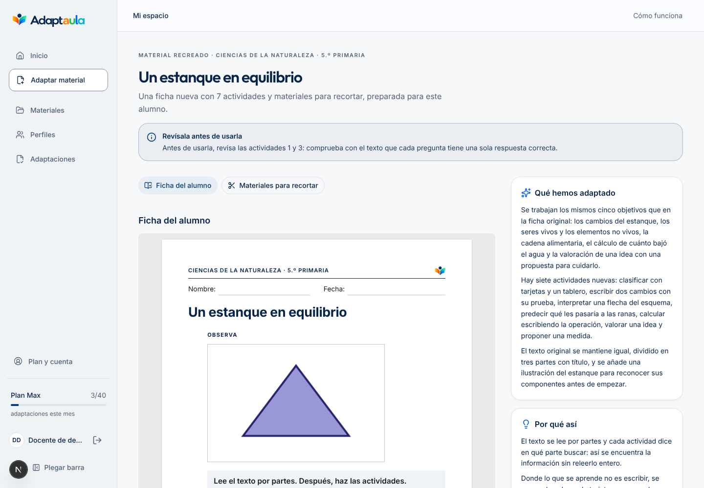
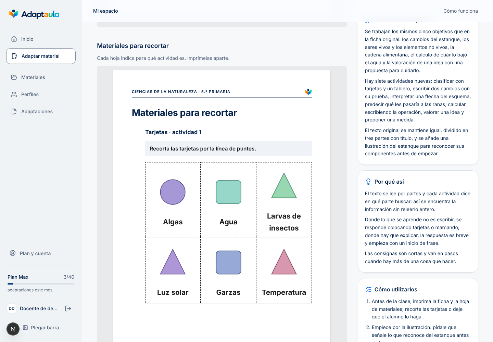
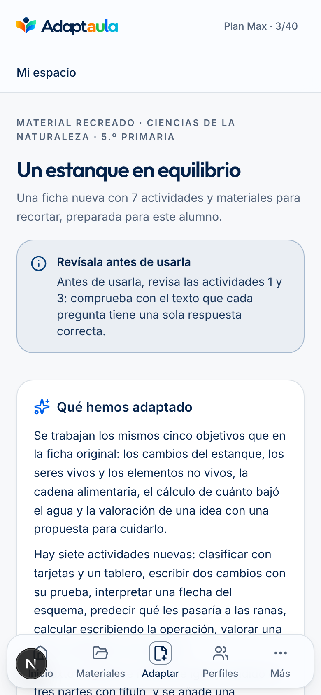

# Recreación en la plataforma: materiales visuales y explicación en pantalla

> **Continuación (ADR-052): seguridad, calidad pedagógica y preparación de la prueba real.** Las secciones nuevas están al
> principio. Las de la entrega anterior siguen debajo, con las correcciones señaladas.

## A. Errores corregidos en esta continuación

1. **Respuestas expuestas en la propuesta de almacenamiento** (grave).
   - **Problema:** `student_document` llevaba `answer_key` y se concedía SELECT a los miembros. Quitar la clave en React no protege una consulta directa.
   - **Solución en el registro:** se guarda en tres partes, igual que en la propuesta de tablas:
     - **línea**;
     - **versión**, solo lo que se muestra; un `CHECK` en la base de datos y el esquema `RecreationVersionSchema` rechazan cualquier `answer_key` no vacía;
     - **interno**, con respuestas, plan, verificación, procedencia y llamadas; tabla con RLS y **sin políticas ni permisos** para `anon` y `authenticated`.
   - **Solución en el código:** la vista recibe un `RecreationReader`, que no tiene ningún método para leer lo interno.
2. **Material presentado como listo sin estar comprobado.**
   - **Problema:** un material cuyas respuestas de clasificación o selección solo están apoyadas en el texto se mostraba sin aviso.
   - **Ahora hay tres estados:**
     - **lista**;
     - **revisión**: un aviso breve que nombra las actividades («Antes de usarla, revisa las actividades 1 y 3: comprueba con el texto que cada pregunta tiene una sola respuesta correcta»), sin dar respuestas;
     - **incompleta**: falta algo imprescindible.
   - Un plan con una actividad inconsistente se **rechaza** (una reparación como máximo) y no se guarda.
3. **El motor de impresión no conocía las imágenes de las tarjetas.**
   - **Problema:** `renderPrintHtml` y `modelAssetRefs` solo fijaban imágenes de bloque. Un PDF con tarjetas ilustradas habría pedido las imágenes por red, y el motor lo habría rechazado.
   - **Solución:** ahora se fijan y se incrustan también las de las tarjetas. Sigue sin permitirse ninguna petición de red (probado).
4. **Las versiones no se podían recuperar y no había idempotencia.**
   - `restoreVersion` y `restore_recreation_version` permiten volver a una versión anterior. Solo puede hacerlo quien tiene permiso de escritura, y solo con versiones que existen. No llaman a ninguna IA.
   - La misma clave de petición no genera dos veces ni reserva dos unidades de cupo.
   - La unidad se reserva antes de llamar y se devuelve si no se guarda nada.

## B. Pruebas ejecutadas

- **Acceso directo a los datos** (`tests/db/recreation-storage.test.ts`, 8 pruebas, PGlite con las migraciones reales más la propuesta):
  - una versión con respuestas se rechaza en la propia base de datos;
  - propietario, docente y lector leen la versión sin ninguna respuesta;
  - **nadie salvo el rol de servicio** lee los internos;
  - otro workspace no ve nada; `anon` no lee;
  - nadie escribe desde el cliente;
  - una versión no puede colgarse de una línea de otro workspace;
  - restaurar: el lector y otro workspace no pueden; una versión inexistente da error; la restauración no borra ninguna;
  - la clave de idempotencia es única.
- **Plataforma** (`recreation-platform.test.ts`, 12 pruebas):
  - lo interno lleva la clave y lo visible no;
  - el esquema rechaza un documento con respuestas;
  - la vista no tiene forma de leer lo interno;
  - estado «revisión» con su aviso sin respuestas;
  - 100 aperturas sin llamadas;
  - imprimir desde lo guardado;
  - idempotencia;
  - cupo, permiso y presupuesto antes de llamar;
  - devolución de la unidad;
  - regenerar con confirmación;
  - **reutilización de las ilustraciones aprobadas** sin sobrescribir;
  - versión antigua y restauración sin llamadas.
- **Recorrido** (`recreation-pipeline.test.ts`, 8 pruebas): 1 ilustración de contexto y 6 de tarjetas, con 7 briefs, 7 imágenes y 7 revisiones simuladas; rechazos; imagen imprescindible ausente.
- **Verificador** (`recreation.test.ts`, 24 pruebas).
- **Evaluación** (`recreation-eval.test.ts`, 9 pruebas):
  - bloqueos de la ejecución real;
  - techo previo;
  - guarda de gasto: una imagen que no cabe no se envía, una llamada fallida cuenta con toda su reserva, un modelo sin precio no se envía nunca, y el texto se mide con el medidor del producto;
  - ensayo completo sin coste.
- **PDF** (`recreation-pilot.test.ts`, 4 pruebas) y **registro de demostración** (1 prueba).
- **Ensayo de la evaluación** desde la línea de órdenes (`RECREATION_EVAL_ARGS="--dry-run" pnpm eval:recreation`):
  - **0 $**, 22 llamadas simuladas;
  - ficha de 4 páginas, materiales de 2 y 7 imágenes;
  - informe y registro de llamadas, todo con el motor real de impresión.

## C. Almacenamiento seguro (propuesta, no aplicada)

[`propuesta-migracion.sql`](propuesta-migracion.sql):

| Tabla | Contenido | Quién lee |
| --- | --- | --- |
| `recreation_lines` | material, `current_version`, `idempotency_key` (única por workspace) | miembros del workspace |
| `recreation_versions` | ficha y materiales **sin respuestas** (CHECK), explicación, estado, referencias a imágenes | miembros del workspace |
| `recreation_internals` | respuestas, plan, verificación, procedencia, decisiones visuales, llamadas | **solo el servidor** (RLS sin políticas, sin permisos) |
| `generated_assets.recreation_line_id` | imágenes de la línea, nunca sobrescritas | miembros (como hoy) |

- **Escritura:** solo el servidor.
- **Restaurar:** función `security definer` con `can_write_workspace`.
- **Cupo:** `consume_quota` / `refund_quota` con clave `recreation:<línea>:v<n>`, en la misma transacción que la inserción de la versión.

## D. Ejemplo visual (simulado)

| Ficha y explicación | Materiales: tarjetas ilustradas |
| --- | --- |
|  |  |

- **Ilustración de contexto**, que abre la ficha: para reconocer el estanque antes de leer.
- **Tarjetas** con una ilustración cada una:
  - mismo estilo (`visual_style`), mismo encuadre;
  - sin marcos ni colores que distingan grupos;
  - **el nombre lo imprime Adaptaula**, no el modelo de imagen.
- **Esquema alimentario** dibujado por código, con los rótulos del original.
- **Tablero de clasificación**, en su propia hoja con su instrucción.
- Las imágenes son **dibujos locales de prueba** (formas y colores distintos por petición), no ilustraciones reales.
- Archivos: [ficha](estanque-ficha-alumno.pdf) · [materiales](estanque-materiales-recortables.pdf) · [móvil](pantalla-movil.png).

## E. Guion de la prueba real (preparado, NO ejecutado)

`evals/recreation/run-real.ts` y `budget.ts`. Se ejecuta con `pnpm eval:recreation`, mediante vitest, el mismo entorno que imprime los PDF de las pruebas.

```
RECREATION_EVAL_ARGS="--dry-run" pnpm eval:recreation                                   # ensayo, 0 $
RECREATION_EVAL_AUTHORIZED=si RECREATION_EVAL_ARGS="--authorized --max-usd 2 --prices-verified AAAA-MM-DD" pnpm eval:recreation
```

- **Motor exacto del producto:** `createRecreation` → planificador (Claude, alias `STANDARD`) → verificación → recursos visuales → `illustrate()` (OpenAI, alias `IMAGE_QUALITY`, y revisión por Claude) → documentos → motor de impresión.
- **Caso:** el estanque con su análisis y su perfil de prueba.
- **Bloqueos.** No se ejecuta si falta cualquiera de estos:
  - `--authorized` **y** `RECREATION_EVAL_AUTHORIZED=si`;
  - `--max-usd` ≤ 3;
  - `--prices-verified` con la fecha en que una persona comprobó los precios vigentes (no anterior a la de la tabla);
  - las dos claves;
  - los modelos configurados listados por cada proveedor (consulta gratuita);
  - que los dos tengan precio en `costs.ts`;
  - que no haya ya una ejecución real (`--again`).
- **Dinero:**
  - un solo libro con el límite;
  - Claude se mide con el `SpendMeter` del producto: cuenta gratuita de tokens, reserva del peor caso antes de enviar y sin reintentos del SDK;
  - OpenAI se mide con un envoltorio igual;
  - plan, reparación, brief, imagen, revisión y cada reintento son peticiones admitidas una a una;
  - **lo que no cabe no se envía.**
- **Resultados** en `evals/results/recreation/<fecha>/` (ignorado por git):
  - `line.json` y `version.json`: lo que vería un miembro, sin respuestas;
  - `internal.json`: local;
  - `assets/*.png`, `student.pdf` y `materials.pdf` con su HTML;
  - `calls.json`: cada llamada con su coste reservado y real, su estado y su error;
  - `report.md`: estado, gasto, rechazos por presupuesto, decisiones visuales y avisos de verificación.

  Para revisarlos sin ninguna API: `ADAPTAULA_DEMO=1 ADAPTAULA_DEMO_DIR=<carpeta> pnpm dev` → `/demo/recreacion`.

## F. Presupuesto máximo y límites efectivos

Calculado con la tabla de `costs.ts`: Sonnet 5.5 a 2/10 $ por millón de tokens y `gpt-image-2` a 5/30 $ por millón, sin verificar contra las páginas de precios actuales.

| Llamada | Techo por llamada |
| --- | --- |
| Plan (o reparación), con ≤ 8 000 tokens de salida | 0,107 $ |
| Brief o revisión de una imagen | 0,023 $ |
| Imagen 1536×1024, calidad media (contexto) | 0,067 $ |
| Imagen 1024×1024, calidad media (tarjeta) | 0,047 $ |
| **Techo del recorrido** (plan + reparación + 7 imágenes × (brief + 2 × (imagen + revisión))) | **≈ 1,63 $** |

- **Propuesta:** `--max-usd 2` para un recorrido. El esperado real ronda 0,6–0,9 $: casi siempre basta un intento por imagen.
- **Límite duro del guion:** 3 $.
- **Esto no es una garantía:** el límite efectivo es el libro, que detiene cualquier llamada que no quepa. Antes de ejecutar, una persona debe comprobar modelos y precios (`--prices-verified`).

## G. Problemas pendientes

- **Sin autorizar ni ejecutar:**
  - la prueba real con Claude y OpenAI;
  - la calidad visual de verdad, sin probar.
- **No aplicado:**
  - la migración propuesta;
  - la conexión a la base de datos de producción (ruta `/app/recreaciones/[id]`);
  - las URLs firmadas;
  - la reserva de cupo dentro de una transacción.
- **Sin comprobar automáticamente:**
  - el **sentido** de las respuestas de clasificación y selección;
  - que el conjunto exija el mismo razonamiento que el original.

  El primero lo cubre ahora el aviso de revisión en pantalla. El segundo es un juicio pedagógico.
- **Revisión de imágenes:** la hace el mismo proveedor de texto (Claude con visión) y las puertas deterministas. Una persona debe revisar las imágenes de la prueba real.
- **Fuera de alcance:** cartas con dos caras y las tarjetas como imágenes recortables a sangre.

---

2026-11-18 · rama `claude/recreacion-plataforma`, sobre `claude/recreacion-colaboracion` (PR #100, que depende de la #99). ADR-051. Sin IA de pago, migraciones remotas, merge ni despliegue. «Hacer magia» y las adaptaciones guardadas no cambian.

## 1. Propuesta visual de la pantalla

Una sola página dentro de la aplicación (mismo `AppShell`, tarjetas, alertas y botones), sin pestañas que carguen nada:

| Escritorio | Móvil |
| --- | --- |
|  |  |

[Página completa en escritorio](pantalla-escritorio-completa.png).

- **Cabecera:**
  - el título, una frase de lo que es («Una ficha nueva con 7 actividades y materiales para recortar»);
  - si hay descargas, «Descargar ficha» y «Descargar materiales», opcionales: no hacen falta para entender la adaptación.
- **Columna derecha, fija al desplazar** (en móvil va **primero**):
  - **Qué hemos adaptado**;
  - **Por qué así**;
  - **Cómo utilizarlos**, en pasos numerados, con un desplegable «Qué observar en cada actividad».
- **Debajo, «Regenerar el material»**, una acción aparte con su aviso: «Se creará una versión nueva… La versión actual se conserva.».
- **Columna principal:**
  - la **ficha del alumno** y los **materiales para recortar**, dibujados por el mismo renderer que el PDF;
  - un acceso rápido a cada uno.
- **Qué no aparece:** solucionario, clave, estados de verificación, procedencia ni avisos técnicos.
- **Si falta algo imprescindible**, una sola alerta en lenguaje llano. Ejemplo: «Falta una imagen necesaria para la actividad 1. No uses la ficha hasta tenerla…».

Demostración local: `ADAPTAULA_DEMO=1 pnpm dev` y abrir `/demo/recreacion`. Fuera de producción, sin sesión ni datos de nadie; lee el registro guardado del estanque.

## 2. Recorrido funcional: se genera una vez y se consulta sin IA

```
crear (única vez)   createRecreation → permisos · cupo · presupuesto → Claude (plan + explicación, 1 llamada)
                    → verificación → imagen (brief → OpenAI → revisión) → MaterialDocuments → RecreationRecord guardado
consultar (siempre) loadRecreationView(store, id) → RecreationScreen          ← sin proveedores, sin pipeline, sin llamadas
regenerar (explícito) regenerateRecreation → permisos · cupo · presupuesto → confirmación → versión nueva (la anterior se conserva)
```

- **La explicación** la redacta Claude en la **misma** llamada del plan (`explanation` en `recreation_plan@v1`) y se guarda con la adaptación.
  - Se valida como cualquier texto del alumno: sin resultados, sin la opción correcta, sin el grupo de un elemento y sin el orden de una secuencia.
  - Además: sin diagnósticos ni etiquetas, y con cada «por qué» ligado a una necesidad funcional del contexto.
- **El estilo visual** es uno por material (`visual_style`) y viaja a cada brief, para que las ilustraciones formen un conjunto.
- **Los materiales** van ligados a su actividad:
  - el tablero de clasificación tiene exactamente los grupos de su actividad;
  - las tarjetas son exactamente sus elementos.
- **Persistencia:** `RecreationRecord`, con la ficha, los materiales, la explicación y las imágenes, más una parte `internal` que la vista nunca envía.
  - En la demo y en las pruebas, en memoria.
  - Para el producto, [propuesta de migración](propuesta-migracion.sql) **no aplicada**. ~~Tabla `recreations` con la clave en `student_document` legible por los miembros~~: **corregido en ADR-052** (sección C). Ahora hay tres tablas y las respuestas solo están en `recreation_internals`, que no puede leer ningún cliente.

## 3. Explicaciones en pantalla (el estanque)

**Qué hemos adaptado:**
- Los mismos cinco objetivos.
- Siete actividades nuevas: clasificar con tarjetas y tablero, dos cambios con su prueba, la flecha del esquema, la predicción sobre las ranas, el cálculo con su operación, valorar una idea y proponer una medida.
- El texto original, dividido en tres partes, más una ilustración para reconocer el estanque.

**Por qué así**, ligado a necesidades sin nombrar diagnósticos:
- se lee por partes;
- se responde colocando o marcando donde no se evalúa la escritura;
- las consignas son cortas y van en pasos.

**Cómo utilizarlos:**
1. Imprimir y recortar.
2. Empezar por la ilustración.
3. Leer cada parte cuando la actividad lo pida.
4. Colocar las tarjetas en el tablero y después escribir las letras.
5. Inicios de frase, o respuesta oral si escribir bloquea.

## 4. Documentos educativos (sin solucionario)

- [Ficha del alumno](estanque-ficha-alumno.pdf), **4 páginas**:
  - la ilustración del estanque abre la ficha, antes de la lectura, porque su función es de contexto;
  - el esquema alimentario va en la actividad 3, dibujado por código con los rótulos del original;
  - 7 actividades de 6 tipos: relacionar con letras, respuesta breve con inicios de frase, selección, cálculo con operación, valoración y propuesta.
- [Materiales para recortar](estanque-materiales-recortables.pdf), **1 página**: 6 tarjetas grandes con línea de corte y el tablero «Ser vivo · Elemento no vivo», cada uno con su instrucción.
- **Ya no se producen** la guía de 2 páginas ni la clave y revisión de 5 de la entrega anterior.
  - Las respuestas siguen **dentro** del registro (`answer_key`, `internal.verification`) para las comprobaciones.
  - No están en la vista: la ficha llega a la pantalla con la clave vacía (probado).
- Una actividad que no supera una comprobación imprescindible bloquea la generación («No hemos podido crear un material fiable… No se ha guardado nada»). Nunca se presenta como correcta.

La ilustración de estas capturas y PDF es el **dibujo local de prueba** de `MockImageProvider` (óvalos), no una imagen del estanque. La revisión página a página de la ficha llevó a tres cambios:
- **La ilustración, al principio:** en la versión anterior iba en la página 2, dejaba media página 1 vacía y llegaba después de la lectura.
- **Ficha de 5 a 4 páginas.**
- **Materiales de 2 páginas a 1:** el tablero quedaba separado de su instrucción; las tarjetas pasan a tres columnas.

## 5. Pruebas de que consultar no llama a ninguna IA

`tests/unit/recreation-platform.test.ts` (9 pruebas):
- **Abrir 100 veces:** se crea la recreación (4 llamadas simuladas: plan, brief, imagen y revisión) y se abre 100 veces; las llamadas siguen en **4** y el almacén registra 100 lecturas.
- **Imprimir desde lo guardado:** construir el modelo de impresión de la ficha y de los materiales a partir del registro no añade llamadas.
- **La vista no puede llamar a una IA:** `view.ts` y `record.ts` no importan en tiempo de ejecución nada de `src/lib/ai`, del planificador, del pipeline de imágenes ni de la creación.
- **La vista no lleva nada interno:** ni clave, ni plan, ni verificación, ni procedencia, ni estados (`verified`, `anchored`…). El registro sí conserva la clave.
- **Regenerar:**
  - sin confirmar, devuelve el aviso y **0** llamadas;
  - confirmado, crea la versión 2 y conserva la 1;
  - sin permiso, sin cupo o sin presupuesto: **0** llamadas y el motivo en lenguaje llano.
- **Plan inválido:** no se guarda.

Además, 24 pruebas del verificador (`recreation.test.ts`), incluidas las nuevas de la explicación (diagnóstico, necesidad ajena, resultado, grupo, opción correcta) y de los materiales (tablero y tarjetas que no casan). Hay 8 del recorrido simulado, 4 de PDF y una que comprueba que el registro de la demo es el que produce el recorrido.

## 6. Qué falta para que OpenAI genere las imágenes reales

1. **Autorización** de la prueba (punto 7).
2. **Configuración** en el entorno de la prueba (no en el repositorio):
   - `OPENAI_API_KEY`;
   - `AI_MODEL_IMAGE_QUALITY` con un modelo de OpenAI de la tabla de precios;
   - `ANTHROPIC_API_KEY` y `AI_MODEL_STANDARD` para Claude (plan, brief y revisión).
3. **Para una prueba controlada** basta un guion local, aún sin escribir a propósito, que use los mismos `createRecreation` e `illustrate()` con proveedores reales y almacén en memoria. No hace falta base de datos.
4. **Para el producto:**
   - aplicar la [migración propuesta](propuesta-migracion.sql) con su prueba de aislamiento;
   - conectar la puerta existente `illustrationAvailability()`: `FLAG_AI_IMAGES_ENABLED`, piloto de un workspace y plan Max con `image_generation` y cupo `monthly_images`;
   - URLs firmadas del bucket privado para la pantalla;
   - una ruta `/app/recreaciones/[id]` con `requireWorkspace`, que es la misma pantalla con el almacén de base de datos.

## 7. Coste máximo de una prueba controlada de las dos IA

Precios de `src/lib/ai/costs.ts` y peores casos de `ILLUSTRATION_BUDGET`.

| Por recreación | Llamadas | Peor caso |
| --- | --- | --- |
| Claude, plan + explicación (≈ 5 k tokens de entrada, ≤ 8 k de salida) + 1 reparación | 1–2 | 0,18 $ |
| Claude, brief de la ilustración | 1 | 0,03 $ |
| OpenAI, imagen + Claude, revisión (+1 reintento) | 2–4 | 0,22 $ |
| **Total** | **4–7** | **≤ 0,43 $** |

**Propuesta: 4 recreaciones**
- el estanque dos veces, para ver la consistencia del estilo y de las explicaciones;
- la célula y las fracciones una vez cada una.

Eso suma **entre 16 y 28 llamadas**, con un **peor caso de 1,72 $** y un esperado entre 0,7 y 1 $. **Tope duro: 3 $**, cortado por el presupuesto antes de cada llamada.

Qué se mirará:
- calidad y coherencia de las ilustraciones, revisadas por una persona;
- utilidad y concreción de las explicaciones;
- planes que pasan la verificación;
- coste real frente al estimado.

**Espera autorización.**

## Qué es real y qué es simulado

| Real (código del producto, probado) | Simulado |
| --- | --- |
| Contrato y verificación, explicación validada, decisión A/B/C, `illustrate()` con sus puertas, compilación, renderer y PDF, registro, vista sin IA, regenerar con controles, pantalla | Claude (`MockProvider` con respuestas fijas: el plan del estanque está escrito a mano), OpenAI (`MockImageProvider`), almacén en memoria, permisos/cupo/presupuesto inyectados |

## Problemas pedagógicos que persisten

- Las respuestas que no se pueden comprobar automáticamente (clasificación y selección) siguen sin comprobar internamente. Ya no se avisa en pantalla, por decisión de producto, así que la responsabilidad recae en el diseño del plan y en la revisión de la evaluación real.
- 7 actividades en 4 páginas para 5 objetivos: la carga adecuada para este perfil debe valorarla un docente.
- Que el conjunto de actividades nuevas equivalga al razonamiento del original sigue siendo un juicio pedagógico, no una comprobación.
