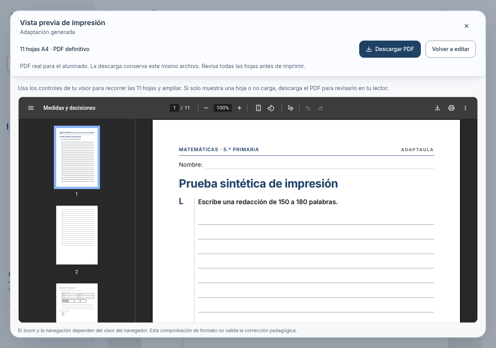
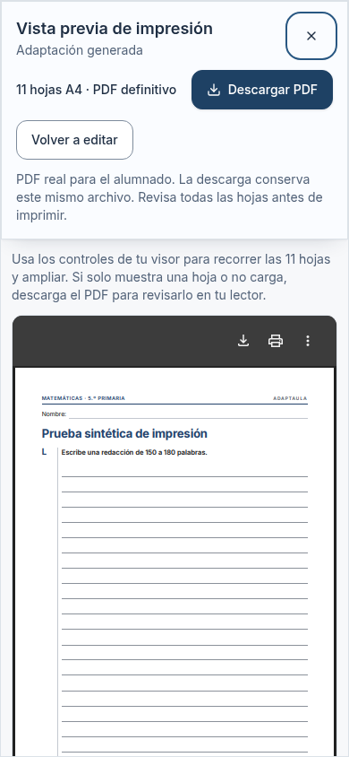

# Vista previa del PDF definitivo

2026-10-20 · base `ef8c1bf` · rama `codex/vista-previa-pdf`. Las PR #49 y #50 estaban fusionadas al iniciar. Sin merge automático, SQL remoto, IA pagada ni migraciones nuevas. La 029 sigue su procedimiento de despliegue independiente; no se aplica aquí.

## Uso docente

En una ficha entregada e imprimible, «Vista previa de impresión» prepara el PDF solo al pulsar. Un diálogo muestra la adaptación generada, el número **físico** de hojas A4 y el archivo en el visor nativo. «Descargar PDF» dentro de ese diálogo descarga el mismo Blob, sin otra petición al servidor. «Volver a editar» abre el editor si existe permiso; un lector vuelve a su ficha.

En el editor, primero se guarda el borrador. La acción se identifica como «Borrador guardado · revisión N» y se desactiva mientras haya cambios pendientes, guardado en curso o una ficha incompleta. Volver a editar cierra la vista y conserva el estado del editor. El PDF nunca representa cambios locales sin guardar. Los avisos pedagógicos, conflictos de guardado y protección de salida continúan vigentes.

Cerrar libera la URL de objeto y cancela la espera del cliente. Si acaba de iniciarse una descarga, se conserva una gracia máxima de 60 segundos antes de revocar la URL para que el navegador pueda consumirla. Cambiar de adaptación, base o revisión desmonta y libera la sesión anterior. Cerrar durante una petición ignora su respuesta tardía; no la vuelve a mostrar. El cliente abandona una preparación tras 75 segundos. Cancelar el cliente **no garantiza** interrumpir un Chromium que ya esté ejecutándose en el servidor.

La descarga directa anterior sigue disponible; fuera del diálogo prepara su propio PDF. La reutilización binaria se garantiza para la descarga del diálogo mientras esté abierto. Reabrir una vista cerrada genera un archivo nuevo, cuya metadata interna puede variar aunque el contenido sea el mismo.

## Contrato y arquitectura

Se conserva una sola ruta privada y un solo motor:

`MaterialDocument → sheetModel → MaterialSheet → HTML de impresión → Chromium → validatePdf`

`GET /api/adaptations/[id]/pdf` invoca `exportAdaptationPdf`. La respuesta añade:

| Cabecera | Procedencia |
| --- | --- |
| `X-PDF-Page-Count` | `pageCount` del archivo comprobado por `validatePdf`, nunca `model.pages.length` |
| `X-PDF-Byte-Length` | Longitud del binario validado; independiente de compresión HTTP |
| `X-PDF-Revision` | `generated` o `draft:N`, solo tras cargar y validar esa revisión |

La previsualización envía `version=N`, y `borrador=N` cuando corresponde. Si la versión generada actual ya no coincide con la base abierta, el servicio devuelve `version_changed`/409 antes de imprimir. No busca otro borrador con el mismo número en otra base. Los consumidores anteriores sin `version` conservan su comportamiento. Una revisión posterior no reemplaza ni el PDF preparado ni la revisión solicitada.

El cliente espera el cuerpo completo; comprueba metadata, longitud, firma `%PDF-`, cierre `%%EOF` y revisión esperada. Un cuerpo interrumpido o truncado no crea URL, visor ni enlace de descarga. La validación estructural y el recuento de páginas se hacen en el servidor; no se añade un parser/compositor de PDF al bundle cliente.

Se mantienen autenticación, workspace de sesión, RLS, lectura de recursos privados, recursos imprescindibles y autorización de borradores. No se introduce un endpoint alternativo, un bucket ni una URL pública. Se conservan `private, no-store`, `nosniff`, `Vary: Cookie`, identificador de solicitud, duración, bytes y códigos de error sin contenido educativo en logs. No se consume cuota de adaptaciones ni se invoca IA. Originales, versiones generadas y revisiones persistidas no se modifican al previsualizar.

## Visor y accesibilidad

Se usa `iframe` con un Blob PDF y título accesible, dentro de un diálogo nativo con Escape, foco inicial, retorno al botón, controles exteriores y mensajes de preparación/error. Papel blanco; controles y tokens existentes. No se simula paginación CSS, no se rasterizan páginas para fingir un PDF y no se instala PDF.js en el cliente.

- Chromium completo local: PDF nativo real, navegación hasta la hoja 11, zoom y descarga comprobados.
- Pantallas móvil y tablet: viewport real de navegador con el mismo binario. No equivale a probar dispositivos físicos.
- `navigator.pdfViewerEnabled` ausente/falso: alternativa explícita de descarga del mismo archivo, sin iframe vacío. Se prueba forzando esa capacidad; no se declara Safari probado.
- Safari/iOS y navegadores integrados pueden mostrar solo la primera página o tener controles diferentes aunque anuncien soporte. La ayuda y la descarga siempre están disponibles para abrir todas las hojas en un lector externo.
- No se automatiza la accesibilidad interna de todos los visores PDF, controlada por cada navegador. Se comprueba teclado/foco, Axe sobre la interfaz propia, reflujo 320 px, texto al 200 %, movimiento reducido y colores forzados. Lectores de pantalla y dispositivos físicos siguen pendientes.
- Las herramientas de anotación del visor nativo son ajenas a CLARO. El botón «Descargar PDF» de Adaptaula conserva el binario preparado; no incorpora anotaciones realizadas dentro del visor. La edición del producto sigue en el editor docente.

## Pruebas y evidencias

Resultados locales:

- **75/75** pruebas focalizadas unitarias/PGlite, diez archivos.
- **33/33** pruebas PDF con Chromium real, cuatro archivos. Tras fijar la base, se repiten exportación y borrador (9/9), y el último cambio del código de conflicto en borrador (1/1); son revalidaciones, no pruebas distintas que se sumen.
- **16 casos de E2E escritorio/móvil verificados**, más **1/1 tablet** de once hojas y descarga idéntica. El lote de 16 dio 15 PASS y un fallo de texto inicial concatenado en el caso previo de conflicto móvil al rellenar inmediatamente tras navegar. Se sincroniza esa prueba con una selección reactiva comprobable, sin sleeps ni relajación de aserciones y sin modificar el editor para ocultarlo; se repite el conflicto en ambos tamaños: **2/2 PASS**. No se ha caracterizado exhaustivamente la escritura durante hidratación fuera de esta prueba.
- Typecheck, lint y build **PASS**; lint conserva un aviso previo por `_id` sin uso en `tests/unit/analysis-run-auth.test.ts`, cero errores. Escáner de secretos y `git diff --check` **PASS**.
- Primeras pruebas nuevas del contrato fallaban por ausencia de contador e integridad y pasan con el arreglo. Se mantiene la prueba de interrupción tras cabeceras. Los primeros ensayos E2E requirieron leer el Blob en vez de un cuerpo vacío de DevTools y coordinar la cancelación de una ruta interceptada; no se altera el producto para sortear esas condiciones.

Capturas directas del navegador, sin retoque y con documentos sintéticos:

| Escritorio | Móvil | Tablet |
| --- | --- | --- |
| [PDF generado](capturas/ordenador.png) | [PDF generado](capturas/movil.png) | [PDF generado](capturas/tablet.png) |
| [Hoja 11 y zoom](capturas/hoja-11-zoom.png) | [Revisión 3, sin visor](capturas/revision-3-movil.png) | |
| [Tabla y figura](capturas/tabla-figura.png) | | |
| [Revisión 3, sin visor](capturas/revision-3-ordenador.png) | | |




Regresiones comprobadas con documentos sintéticos y proveedores simulados; no validan la pedagogía del generador real:

| Caso | Evidencia |
| --- | --- |
| Actividad de una hoja y actividad que continúa | `tests/pdf/smoke.test.ts` |
| Tabla de 40 filas, cabeceras y filas conservadas | `tests/pdf/smoke.test.ts` |
| Figura íntegra, consigna, respuesta extensa y claves ausentes | `tests/pdf/smoke.test.ts`, `export.test.ts`, `editor.test.ts` |
| 10 páginas lógicas → 11 físicas | `tests/pdf/export.test.ts`, `tests/support/print-preview-document.ts`, E2E del visor |
| Contador del endpoint = páginas del archivo validado | `tests/pdf/export.test.ts` en todas sus exportaciones |
| Borrador con tipografía/espaciado y revisión anterior a otra | `tests/pdf/editor.test.ts`, E2E revisión 3 frente a revisión 4 |
| Vista y descarga idénticas | SHA-256 del Blob del visor y del archivo descargado, E2E |
| Sin preparación automática ni doble petición por doble clic | E2E del visor |
| Fallo Chromium, desconexión y cuerpo incompleto | integración del endpoint, unitarias y E2E con fallos inyectados |
| URL liberada, descarga al cerrar y respuesta tardía | unitarias con reloj controlado y E2E de cierre |
| Aislamiento, rol lector y versiones corruptas | `tests/db/pdf-export.test.ts`, `tests/e2e/document-review.spec.ts` |
| Original y documento generado intactos; cuota sin cambios | E2E del visor y `footprint` de integración/exportación |

Comandos focalizados (no la suite completa):

```bash
pnpm exec vitest run tests/unit/pdf-download.test.ts tests/unit/pdf-preview.test.ts tests/unit/pdf-preview-route.test.ts tests/unit/pdf-single-renderer.test.ts tests/unit/sheet-editor.test.ts tests/unit/pdf-validation.test.ts tests/unit/boundaries.test.ts tests/unit/adaptation-web-boundaries.test.ts tests/db/pdf-export.test.ts tests/db/render-integration.test.ts
pnpm exec vitest run --config vitest.pdf.config.mts tests/pdf/export.test.ts tests/pdf/editor.test.ts tests/pdf/smoke.test.ts tests/pdf/engine.test.ts
pnpm exec playwright test tests/e2e/pdf-preview.spec.ts tests/e2e/document-review.spec.ts tests/e2e/sheet-editor.spec.ts tests/e2e/render.spec.ts
pnpm typecheck
pnpm lint
pnpm build
pnpm check:secrets
```

Entorno de navegador: Chromium 154 completo en `/usr/bin/chromium`; motor de impresión del producto: Chromium serverless 153, sin cambios. Configuración temporal equivalente a Playwright del repo, con `executablePath` explícito, sin relajar aislamiento, contra `next dev` y el Supabase falso local/PGlite. Proveedores `mock:default`, imágenes IA desactivadas. No se conecta a Supabase real. En este Chromium, DevTools puede devolver un cuerpo PDF vacío al tomarlo el visor; el E2E lee el Blob real para comparar hashes, sin regenerar un documento.

## Despliegue y límites pendientes

No hay migración nueva. Publicar API y cliente del mismo build: los clientes nuevos requieren el contrato de cabeceras nuevo y fallan de forma cerrada ante una API antigua. No se ha desplegado ni comprobado Vercel; falta probar el runtime de Chromium y la descarga autenticada en staging expresamente autorizado. Build local no acredita ese runtime.

Siguen los límites técnicos existentes: hasta 60 hojas y 20 MiB por PDF, tiempo de la ruta de 60 segundos, sin persistencia/caché de PDF en el servidor y sin nuevo limitador global de render. La protección local evita duplicar una petición desde ese control, no limita pestañas o usuarios simultáneos. No se modifica la semántica de trabajos, cuotas, planes o revisión pedagógica. No se declara cumplimiento legal ni exactitud semántica del material.

Siguiente acción: revisar esta PR y, tras integración manual, validar el PDF en staging con el procedimiento de 5B y autorización independiente. No activar OCR, imágenes IA, pagos ni cambios pedagógicos para hacerlo.
